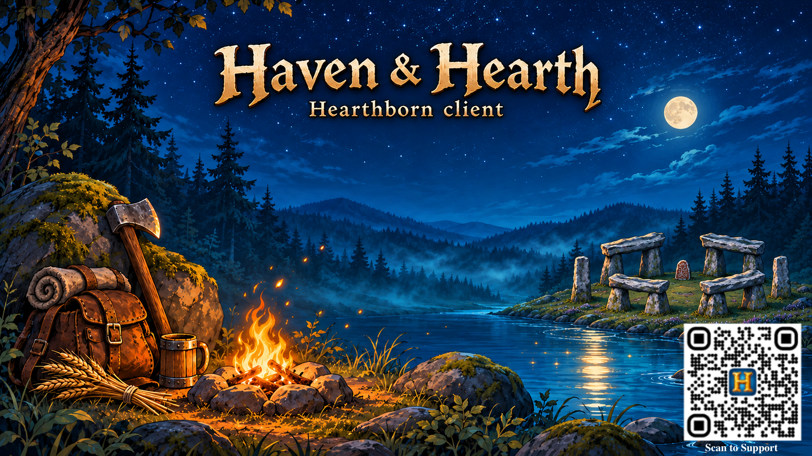

# Hearthborn Client

**An independent, unofficial custom client for Haven & Hearth**

*Customize your interface. Simplify production. Explore with better tools.*

[**Documentation**](https://jagy2014.github.io/hearthborn/) · [**Русская документация**](https://jagy2014.github.io/hearthborn/ru/) · [**Support development**](https://buymeacoffee.com/hearthborn_client)

Hearthborn builds on the original Haven & Hearth client to make everyday gameplay more convenient, with a customizable interface and practical tools for production, storage, exploration, planning, and automation.

## Features

- **Interface & controls:** Movable system strip and toolbars, interface widgets, enhanced Inspect, and redesigned character and equipment windows.
- **Production & management:** Container labels, inventory transfers, quality and cattle rosters, cheese tracking, automatic timers, and Xtensions.
- **Navigation & exploration:** Improved pathfinding, the map in a separate window for a second monitor, mapping tools, claim planning, and meteorite triangulation.
- **Mining & combat:** Mining safety tools and combat assistance.

See the **[complete feature documentation](https://jagy2014.github.io/hearthborn/)** for detailed descriptions and screenshots.

## Download and install

Hearthborn is installed with its **launcher**. The launcher has Java 22 built in, downloads the client, checks it, starts it, and offers client updates when they appear.

1. Open the **[latest release](https://github.com/Jagy2014/hearthborn/releases/latest)** and download the launcher archive for your system:

   | System | File |
   | --- | --- |
   | Windows (64-bit) | `hearthborn-launcher-windows-x86_64.zip` |
   | macOS, Apple Silicon (M1 and newer) | `hearthborn-launcher-macos-aarch64.zip` |
   | macOS, Intel | `hearthborn-launcher-macos-x86_64.zip` |
   | Linux (64-bit) | `hearthborn-launcher-linux-x86_64.zip` |

2. Unpack the **whole archive** into a folder of your own (the runtime is inside it, so do not move single files out) and start the launcher: `Hearthborn.exe` on Windows, `Hearthborn.app` on macOS, `Hearthborn/bin/Hearthborn` on Linux.
3. On the first start the launcher downloads the client (about 100 MB) and starts the game. Later, if a new client version appears, it asks whether to download it; it can also start an older installed version.

**The launcher is not code-signed yet**, so the system warns you on the first start:

- **Windows:** in the SmartScreen window click **More info → Run anyway**.
- **macOS:** Control-click (right-click) `Hearthborn.app` and choose **Open**, then **Open** again. If macOS still refuses, run `xattr -dr com.apple.quarantine Hearthborn.app` in Terminal once, or use **System Settings → Privacy & Security → Open Anyway**.

The launcher does not update itself. When a newer launcher exists, it tells you once and shows a **New launcher…** button that opens the release page; download the archive again and replace the old folder. Your client versions and game data are stored separately and stay:

| System | Folder |
| --- | --- |
| Windows | `%LOCALAPPDATA%\Hearthborn` |
| macOS | `~/Library/Application Support/Hearthborn` |
| Linux | `~/.local/share/hearthborn` |

Logs are in `game/logs/client.log` and `launcher.log` inside that folder; include them when you report a problem.

## Documentation

Full guides and interface information are available on the **[Hearthborn documentation website](https://jagy2014.github.io/hearthborn/)** in English and Russian.

**Languages:** English and Russian (approximately 98% of the client translated into Russian)  
**Technology:** Java 22 / Apache Ant

The client source code is in this repository. Documentation sources are maintained in [`docs/`](docs/) on `master` and published automatically to GitHub Pages.

## Privacy

**Hearthborn does not send your data to third-party services.** It only sends the data required to connect to and play on the official **Haven & Hearth servers**.

## Support development

Hearthborn is free for everyone. Donations are voluntary and help support development; they do not unlock exclusive features or provide in-game advantages.

[**Support Hearthborn on Buy Me a Coffee**](https://buymeacoffee.com/hearthborn_client)

## Credits and license

Hearthborn is an independent, unofficial project based on the Haven & Hearth client. The original game and client belong to their respective authors. Upstream license obligations remain applicable; consult the original client for its license terms.

## Screenshots

For interface screenshots, feature demonstrations, and illustrated guides, visit the **[documentation website](https://jagy2014.github.io/hearthborn/#screenshots)**.
