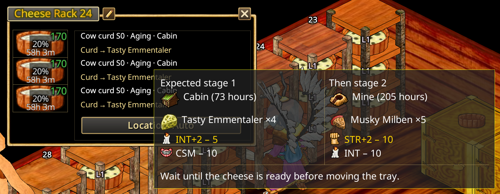
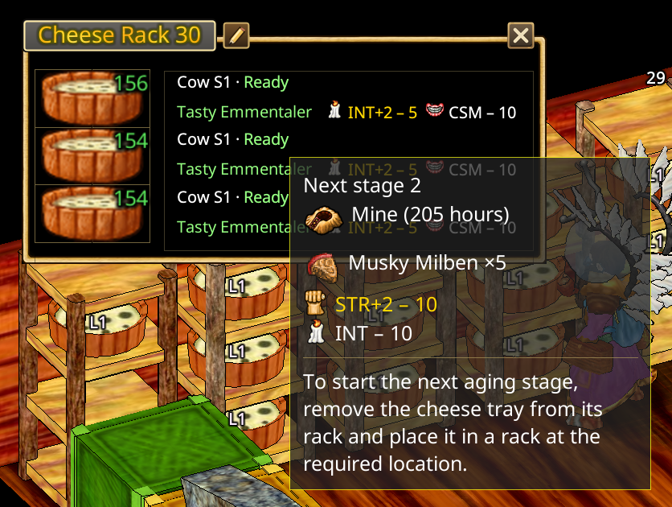
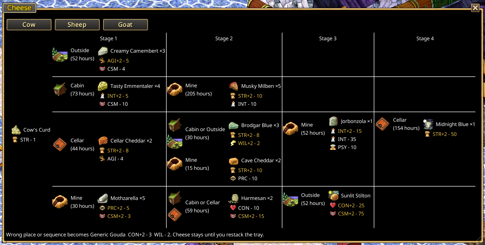

# Cheese production assistant

Follow cheese progression for cow, sheep, and goat milk. Inspect aging stages and expected products, see labels on racks, and track observed batches in the **Cheese** tab of Timers.

## Stage tooltip

Hover a tray in the rack window to see the stages ahead: the location where
the cheese should age, how long that takes, the cheese you expect to get and its
bonuses.

While the cheese is still aging, the first column is titled **Expected stage**
and shows the stage the tray is waiting for. The tip asks you to wait until the
cheese is ready before moving the tray.

Once the cheese is ready, the first column becomes **Next stage**. To start it,
take the tray out of its rack and place it in a rack at the required location.

I also added a **cheese progression chart** to make it easier to plan cheese production and choose the right aging stages and locations.

[Back to features](../index.md#features)
