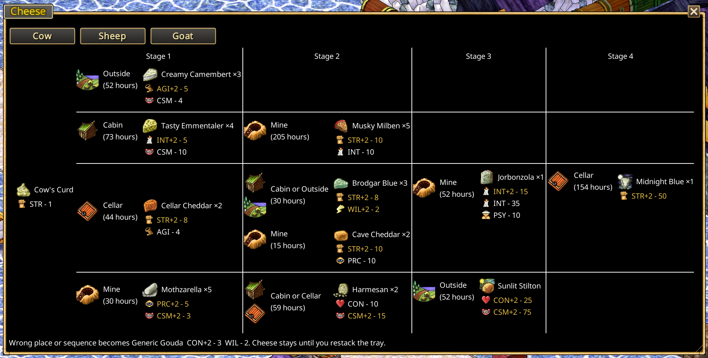
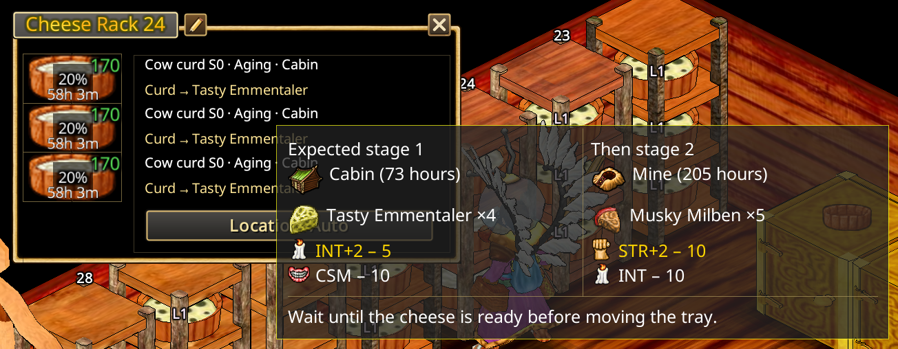
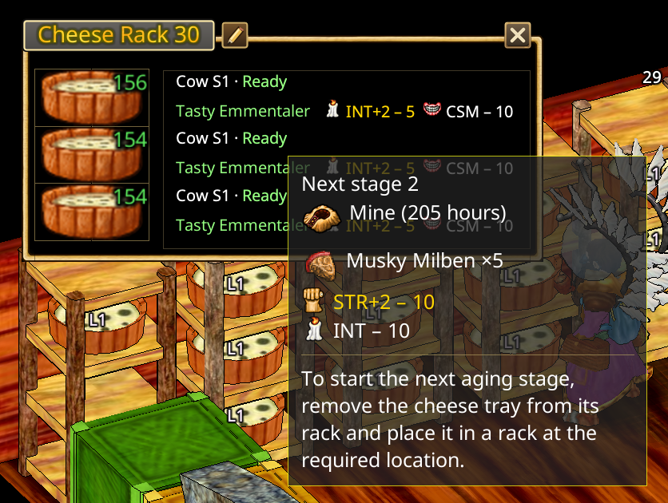

# Помощник сыровара

Помощник показывает стадии созревания сыров из **коровьего, овечьего и козьего молока**. Можно следить за переходами между стадиями, использовать подписи на стеллажах и таймеры, чтобы вовремя перемещать сыры.

## Подсказка о стадии

Наведите курсор на лоток в окне стеллажа, и появится подсказка о ближайших
стадиях: где должен созревать сыр, сколько это займёт, какой сыр получится и
какие у него бонусы.

Пока сыр ещё созревает, первая колонка называется **Ожидается стадия** и
показывает стадию, которой лоток дожидается. Подсказка просит дождаться
готовности сыра, прежде чем переносить лоток.

Когда сыр готов, первая колонка становится **Следующая стадия**. Чтобы начать
её, достаньте лоток из стеллажа и поставьте в стеллаж в нужном месте.

Информация основана на наблюдаемых клиентом данных. Помощник не ускоряет созревание и не выполняет всю производственную цепочку автоматически.

[Все функции](../index.md#features)
