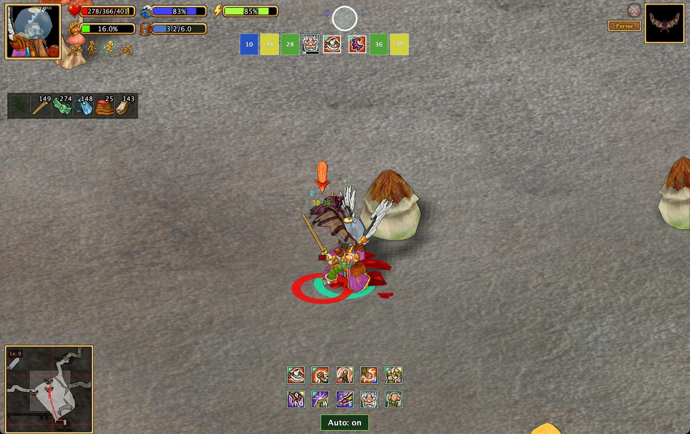
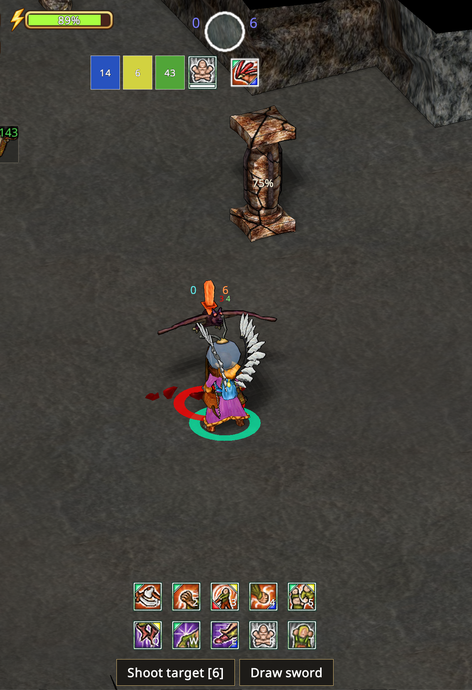
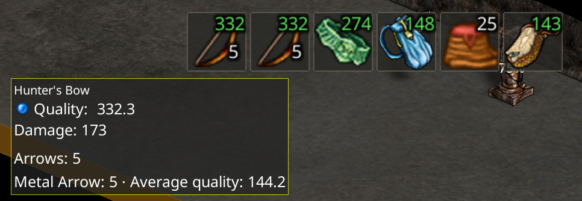
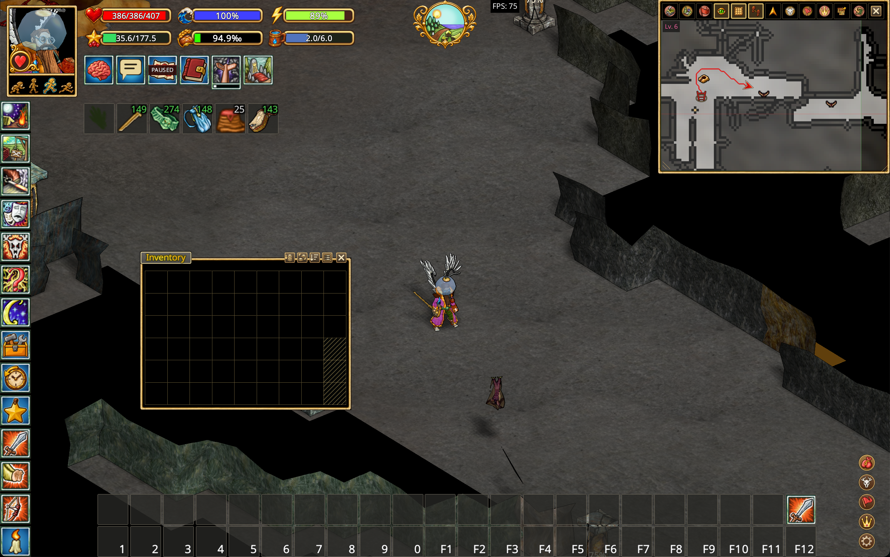
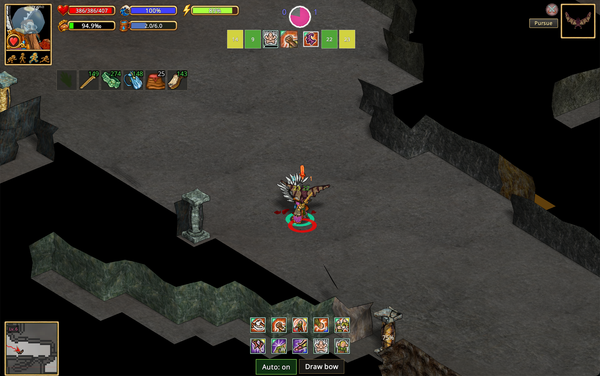

# Combat assistance

## Animal auto-combat

The setting is named **Combat assistance with animals**. It assists with the
current fight; it does not choose or engage nearby animals.

Stage 1 animal auto-combat is intended to help newer players with simpler encounters, such as ants and bats. During an **existing animal fight**, it automatically uses supported **attacks** against the target. **Combat moves are not yet used**; further development is planned.

It does **not** engage targets, position your character, or fight other players for you.

## Bow shooting

With a hunter's or ranger's bow equipped, **Shoot target** makes one shot at the
current animal opponent. The helper activates Shoot and confirms the animal when
the server's aim cursor appears. No second manual target click is needed. Every
shot requires a new button press: there is no repeated shooting, retry loop or
automatic resume after movement or recovery. Move, board your boat and approach
the shore yourself; press Shoot target when you are stationary and ready.

The screen button remains available during combat. **6** also fires one shot
while fighting with a bow; change it under **Key bindings → Combat → Shoot target**.
The native deck keys **1–5 and Q W E R T** keep their usual actions. Outside a bow
fight, 6 retains its numeric hotbar action. Holding the shortcut does not repeat
shots. The shooting action has been removed from Xtensions. Without a selected
animal, Shoot target asks you to choose one in the world.
Right-click or Escape cancels selection. Existing peace offers do not hide the
selected animal. Player targets are excluded. Once the shot finishes, its aim
cursor is cancelled so the next ground click moves normally. Starting movement
also cancels an unfinished shot before sending the movement command.

The neighboring weapon button changes with your equipment:

- **Draw sword** replaces the held bow with a sword from your inventory or nested bags.
- **Draw bow** brings a carried bow back into your hands.
- **Put away bow** stores the bow when you have no carried sword.

Weapon changes happen only on a button press. The helper waits for item receipts
and returns the displaced weapon to available bag space. It never drops weapons
on the ground. Make room before switching; if bag space disappears mid-switch,
place the held item manually. Escape stops pending switch steps. Bow entry
releases inherited combat actions and disables melee assistance; enable melee
assistance explicitly if wanted after switching to a sword. Later manual combat
cards and weapon shortcuts retain their usual behavior.

The bow icon in the equipment strip shows the total carried arrows. Its tooltip
lists quantities and average quality by arrow type, including packets and quivers.

## Compact interface

The compact combat interface temporarily hides nonessential windows and widgets so you can focus on the fight. Press **Alt+Space** to toggle compact UI, including outside combat.

[Interface customization](interface.en.md) · [Back to features](../../README.md#features)
