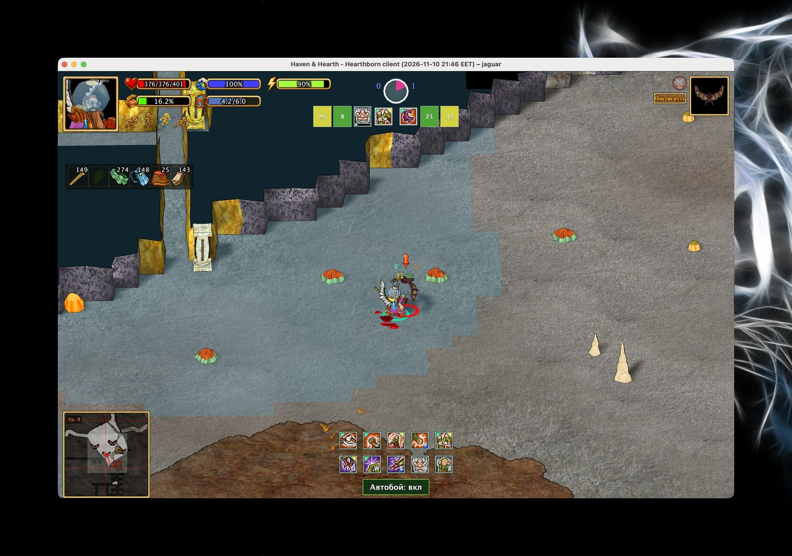
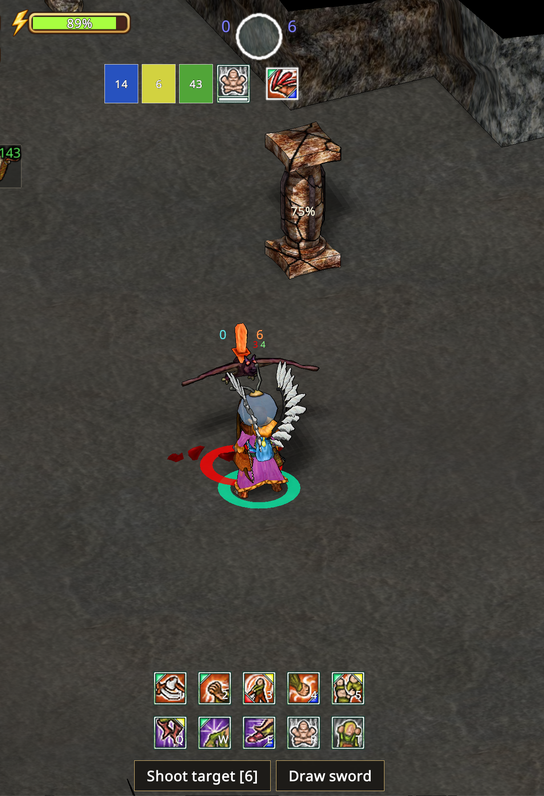
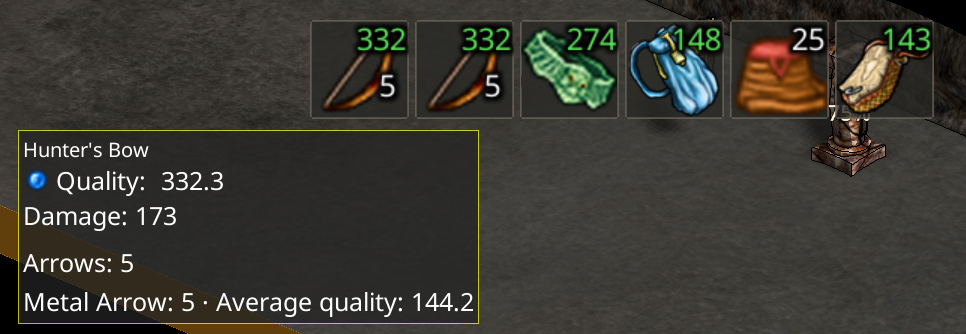
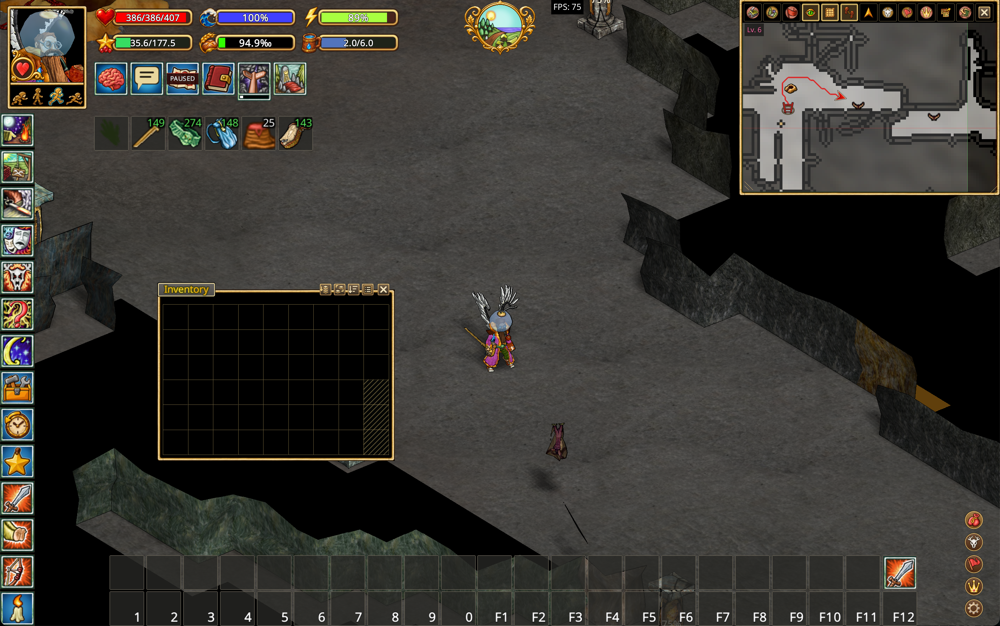
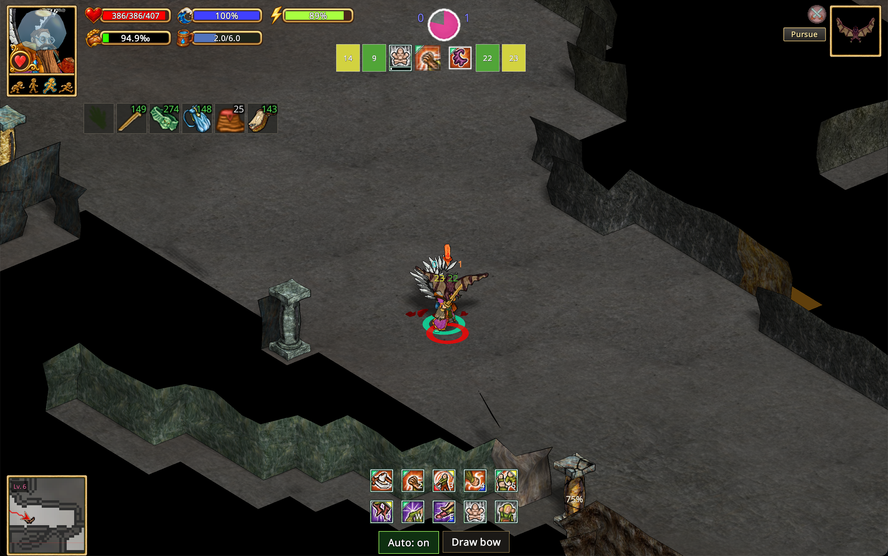

# Помощь в бою

## Автоматический бой с животными

Настройка называется **«Помощь в бою с животными»**: она помогает с текущим боем,
сама не выбирает и не атакует животных вокруг.

Первый этап автоматизации помогает атаковать поддерживаемых животных, включая муравьёв и летучих мышей. Клиент выбирает подходящие **атаки из активной колоды**. Автоматического использования боевых приёмов и полноценного управления тактикой пока нет.

## Стрельба из лука

С луком охотника или следопыта кнопка **«Выстрелить»** делает один выстрел по
текущему противнику-животному. Помощник включает стрельбу и сам подтверждает цель
после появления серверного прицела. Дополнительно кликать по животному не нужно.
Каждый выстрел требует нового нажатия: повторной стрельбы, повторных попыток и
возобновления после движения или восстановления нет. Передвигайтесь, садитесь
в лодку и подплывайте к берегу сами; нажимайте «Выстрелить», когда остановились
и готовы стрелять.

Экранная кнопка остаётся в бою. **6** также делает один выстрел в бою с луком;
клавиша меняется в **«Сочетания клавиш → Бой → Выстрелить»**. Прежние боевые
клавиши **1–5 и Q W E R T** сохраняют обычные действия. Вне боя с луком 6 работает
как прежде на панели быстрого доступа. Удержание клавиши не повторяет выстрелы.
Из Xtensions стрельба убрана. Если животное ещё не выбрано, «Выстрелить» предложит
выбрать цель в мире. Правый клик или Escape отменяют выбор.
Предложение мира не скрывает уже выбранное животное. Игроки не становятся целями.
После окончания выстрела прицел сбрасывается: следующий клик по земле позволяет
идти. Начало движения также отменяет незавершённую стрельбу перед командой движения.

Соседняя кнопка меняет подпись по ситуации:

- **«Взять меч»** меняет лук на меч из инвентаря или вложенных сумок.
- **«Взять лук»** возвращает лук из вещей в руки.
- **«Убрать лук»** убирает лук, если меча в вещах нет.

Оружие меняется только по нажатию. Помощник ждёт подтверждения перемещения
предметов и возвращает освободившееся оружие в свободное место в сумках. На землю
оружие не выбрасывает. Перед сменой освободите место; если оно закончилось во время
обмена, положите предмет с курсора вручную. Escape останавливает оставшиеся шаги.
При переходе на лук отпускаются прежние боевые приёмы и выключается помощь
в ближнем бою; после смены на меч её можно включить вручную. Ручные боевые приёмы
и горячие клавиши смены оружия сохраняют обычное поведение.

На значке лука в полоске снаряжения показано общее количество стрел, а в подсказке -
количество и среднее качество каждого типа, включая паки и колчан.

## Компактный интерфейс

Компактный вариант боевой панели оставляет на экране важную информацию, занимая меньше места.

Автоматизация не гарантирует победу: следите за состоянием персонажа и обстановкой.

[Все функции](../index.md#features)
