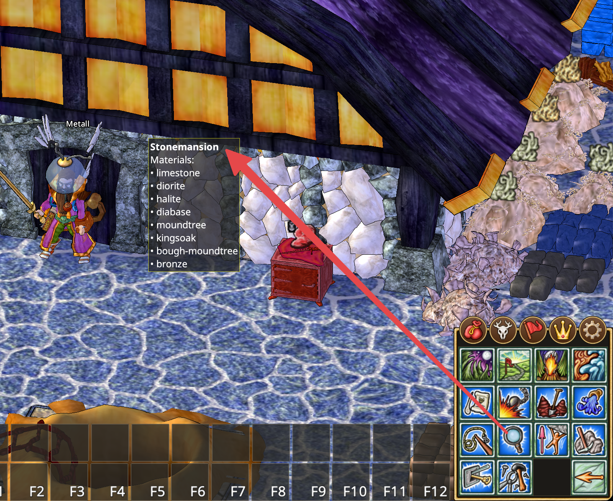
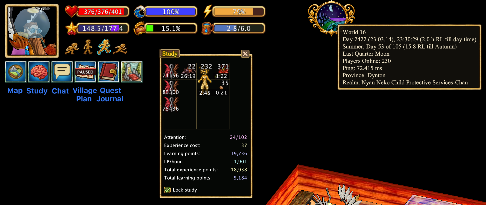
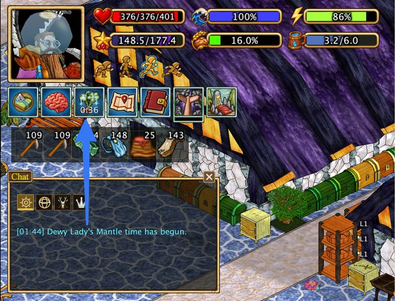
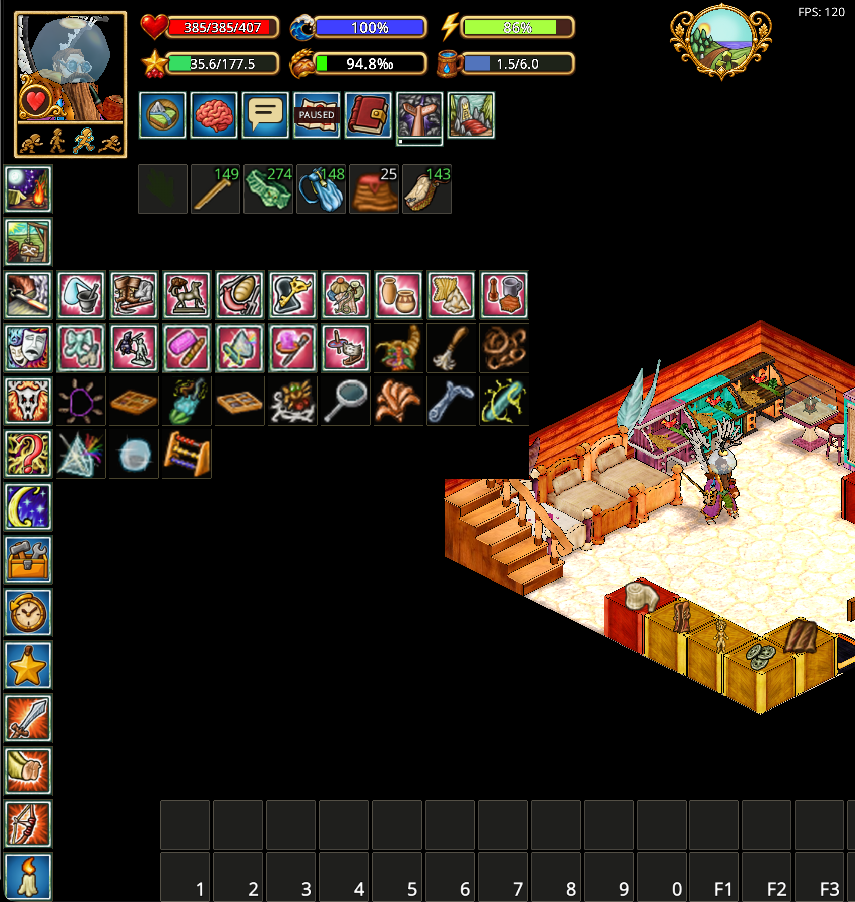
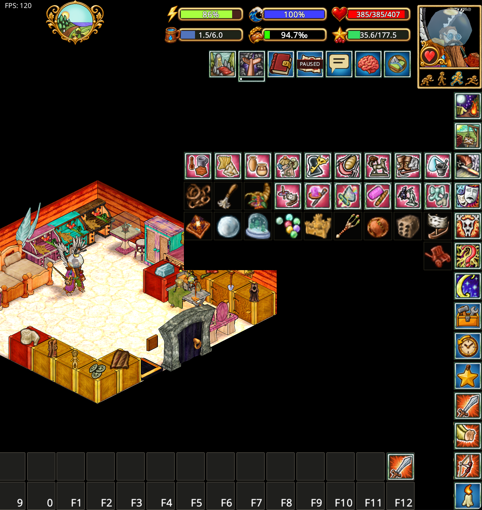
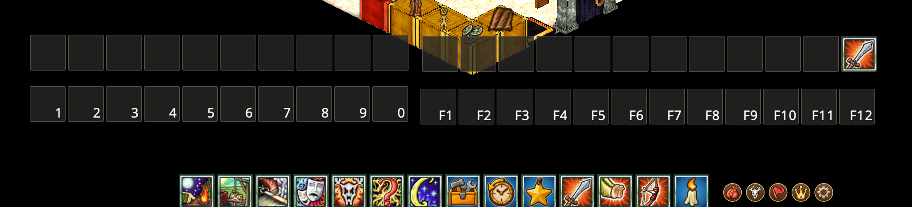
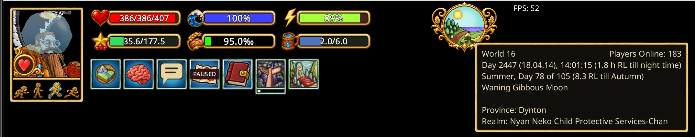
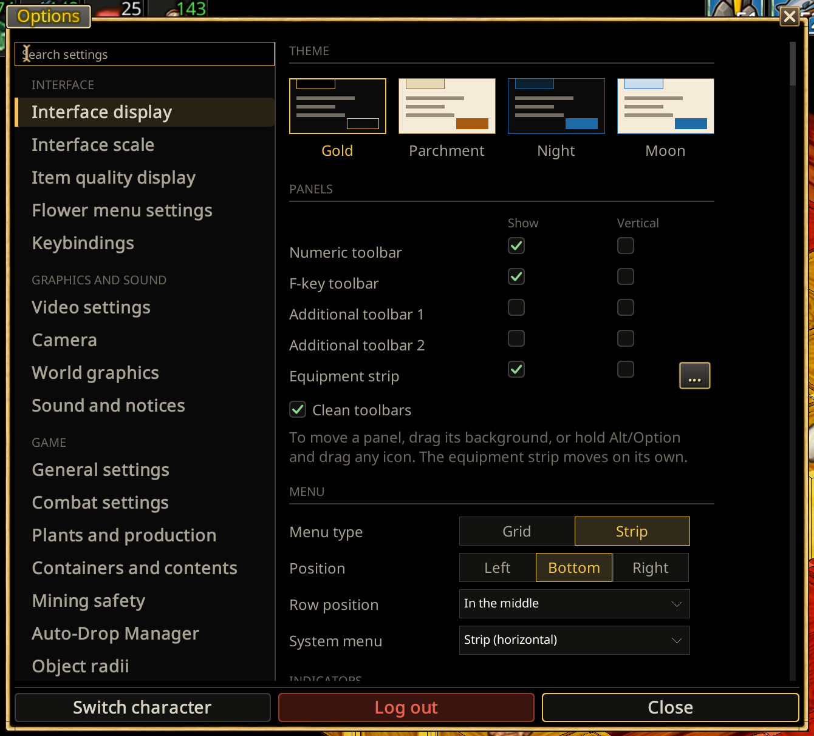
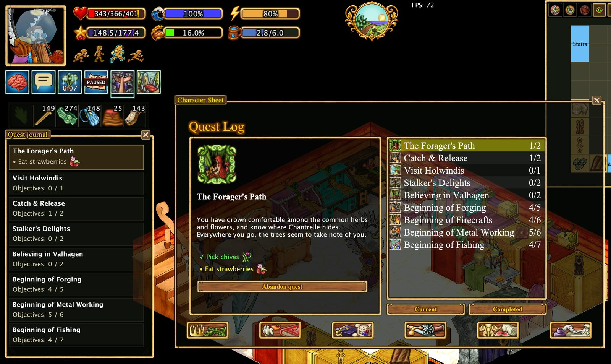
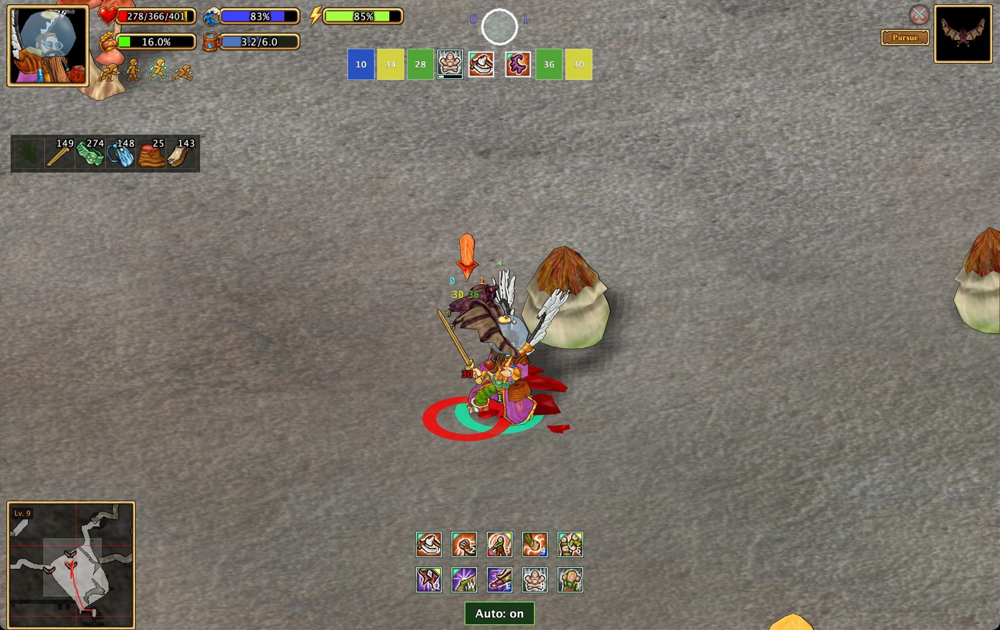

# Redesigned Hearthborn interface

Hearthborn provides a fully configurable in-game interface. You can keep the familiar Haven & Hearth action grid, use an expandable sidebar, and arrange the surrounding panels to suit your screen and play style.

## Sign-in and character selection

Sign-in shows the traveler by the fire; character selection uses the blue Ring of Brodgar landscape without the traveler. Log out sits below New character. Both buttons have the same width. Account badges sit to the right of the character at the height of the character list.

The custom painting stays visible while server screens arrive. After Play, a gold **Loading…** message covers the transition until the map appears. The loading display does not wait for every nearby object or block input while fetching its decorative texture. The message follows the client language.

## Attribute and ability tooltips

Hover over a base attribute or ability in the character sheet to see a short description of its effects on combat, crafting and other mechanics. These summaries are based on Ring of Brodgar's [Attributes](https://ringofbrodgar.com/wiki/Attributes) and [Abilities](https://ringofbrodgar.com/wiki/Abilities) pages, support English and Russian, and work offline. The original breakdown of the base value and modifiers remains above the description.

## Roast fish and meat previews

Raw fish, filets and meat show a preview of an ordinary unseasoned roast. The character's world is selected using the ID supplied by the server. For worlds 16 and 16.2, hunger per piece in promille is `(sum of +1 FEP + 2 × sum of +2 FEP) / food ratio × (quality / 10)^(1/4)`. FEPs still scale with the square root of quality, so better quality improves FEP per hunger. For example, roast eel uses 0.64‰ at Q10 and 1.28‰ at Q160.

The preview uses raw ingredient quality; actual roast quality is capped by Perception and Survival. The fresh roast bonus increases both FEP and hunger by 25%. Table bonuses are excluded. Cooked food keeps the server's own information. An unverified world or food ratio shows a dash and an explanation instead of a hunger estimate.

The formula follows the [World 16 announcement](https://www.havenandhearth.com/forum/viewtopic.php?f=39&t=76519). [World 16.2](https://www.havenandhearth.com/forum/viewtopic.php?f=39&t=80996) changes to hunger recovery over time do not replace the food's hunger cost. Ratios and base-value corrections were checked on November 12, 2026 against [Kitten Rider Cookbook](https://cookbook.kittenrider.com/), with data under [CC BY 4.0](https://creativecommons.org/licenses/by/4.0/); the client contains adapted values. Hovering does not use the network.

## Enhanced Inspect

The **Inspect** action reveals additional information about objects in the world. For example, inspecting a building can show **which materials were used to construct it**, including the different stone, wood, and metal materials recorded for the structure.

**Hold Shift while inspecting** to display technical information, including the object's **in-game resource name**. This is useful when you need to identify the exact game resource rather than only its visible name.

## Interface widgets

Hearthborn provides compact **widgets** for frequently used windows and information. They keep essential controls accessible without leaving every full-sized window open.

- **Map:** You can close the map completely. A **Map widget** remains available; click it to reopen the map.
- **Chat:** When the chat window is closed, a **Chat widget** appears. An indicator on the widget shows unread messages; click it to open the chat. You can optionally enable **automatic chat opening when a new message arrives** in the settings. **System messages do not count** as new chat messages and do not trigger automatic opening.
- **Study:** A **brain icon** appears when there are free slots in the study window. Click it to open the **compact study window**.
- **Claim Plan:** Click to open the **village or personal claim plan**.
- **Quest Journal:** Click to open the quest journal. **Hover** over the widget to see the active quest and its objectives.
- **Clock:** **Hover** over the clock to see additional world and session information. You can also enable **FPS and server ping indicators** in the settings; they appear **to the right of the clock**.
- **Lady's Mantle:** at dawn (04:45–07:15 game time) a status icon with a countdown appears, together with a sound and a chat message when the time begins and ends. The notification can be switched off in the general settings.

## Cupboard contents at a glance

Hearthborn displays an **item icon above each cupboard**, automatically choosing the item that is **most common inside**. You only need to **open the cupboard once** for the client to learn its contents. You can also choose a different icon manually in the cupboard's settings and adjust the indicator's size and color.

The same previously observed cupboard information can also be displayed on the **room plan** described below. The room plan does not collect it itself.

## Room plan

The original indoor map showed the current house as a square, with other nearby houses appearing as squares against a black background. Hearthborn replaces that view with a **room plan** in the same map area.

The room plan displays the layout of the current house and can show the **contents of cupboards that have been opened at least once**. This information is not collected by the room plan itself: **a separate script records the cupboard contents**, and the room plan displays the information that was already gathered. Cupboards that have never been opened do not have observed contents to display.

This gives the indoor map a practical purpose: seeing where previously inspected items are stored without opening every cupboard again.

## Remaining structure health

Enable **Options → General settings → Show remaining structure health (%)**, the first checkbox in the right column. Damaged structures are tinted red and show their remaining health: **75% means a quarter is damaged**. Fully repaired structures have no label.

## Hide trees and bushes

Press **Ctrl + H** to hide trees while keeping their **stumps visible**. This makes it easier to see the ground and objects that would otherwise be obscured by foliage, without losing track of where the trees stand.

By default, **Ctrl + H hides trees only**. To hide **bushes as well**, enable the corresponding option in the settings. Bushes do not have their own stumps, so hidden bushes are represented by a **small mulberry-tree stump** instead.

Hearthborn also displays **tree growth stages**, helping you identify how far trees have developed.

**Trees and bushes hidden**

**Trees and bushes visible**

## Choose your action menu

In **Options → Interface display → Menu**, **Menu type** has two choices: **Grid** and **Strip**. There is no other menu type.

**Grid** (the classic menu) preserves the familiar 4×4 action hierarchy and navigation. **Side** puts it in the bottom-left or bottom-right corner. **Xtensions menu** chooses how the extended commands open: **Normal (4×4)**, **Upward (4×12)** or **Sideways (12×4)**.

### Classic menu layouts

The classic menu can sit in the **bottom-left** or **bottom-right** corner, with the portrait and status bars positioned independently.

**Quick return to the main menu:** Instead of pressing Back repeatedly through each submenu, **right-click (RMB) the Back button** to jump directly to the top-level (home) action menu. A normal left-click still returns one level at a time.

**Classic menu on the left**

**Classic menu on the right**

### Sidebar menu

The **Sidebar menu** (**Menu type → Strip**) replaces the grid with a list of action categories. Click a category to expand its actions beside the sidebar; subcategories expand in place. Switch between the two types in **Options → Interface display → Menu**.

The sidebar is **pinned and cannot be dragged**. **Position** puts it on the **Left** or **Right** edge as a column, or at the **Bottom** as a row (the numeric toolbar moves above it); for the row, **Row position** puts it on the left, in the middle or on the right. Opened menus always stay within the column's height.

Newly discovered actions and the categories leading to them use the same green
highlight and brief flashing as the classic grid.

## Movable system menu

The classic menu always has its system buttons **around the 4×4 grid**, so the
**System menu** choice is hidden there. With the Sidebar menu selected, choose
**Strip (horizontal)** (the default) or **Strip (vertical)** in
**Options → Interface display → System menu**. The choice is saved and applied
immediately, and all layouts use the same buttons, states and shortcuts.
The strip holds Inventory, personal claims, village claims, provinces and Options.
Equipment and the Character Sheet are clicks on the portrait: **left click** opens
equipment, **right click** the character sheet (a tooltip on the portrait says so). It has no backing, always keeps scale 1.0 and does not
follow the panel scale slider. Kith & Kin is the heart on the portrait, and
Search actions is the last item of the sidebar menu.

With the classic grid the system buttons are one row of five buttons above it, exactly as wide
as the grid: Inventory, Equipment, Character, Kin and Options. The claim toggles
(personal claims, village claims, provinces) are in the action menu under
**Self-government**, and Search actions is the last item of the main grid.
A single dark backing
joins the grid and its button rails. Its gold frame matches the other panels;
the round buttons leave a clear gap inside it and use bright two-pixel gold
rings. All system buttons use the same dark disks with separate foreground
symbols, including a cog without an outer ring for Options. Hover brightens the ring; an open window or enabled
claim layer gives its disk a dark-gold fill. The disks are
a fifth of the grid's width. When Xtensions expands sideways, the top row stays over the first four
columns, leaving the remaining space on the right empty. This layout moves with the grid;
with Sidebar selected the strip is used until you return to Classic.

Empty cells in the action grid and numeric, F-key and additional toolbars share
the same dark fill and fine outline. Assigned key labels remain visible.

The **strip** can be moved around the screen just like the additional toolbars, and **stays where you place it**. Its saved position is retained while the classic grid is selected, and restored when you switch back.

To move it, **drag the gap between buttons** directly, or **hold Alt (Option on Mac) and drag a button**. Dragging a button with Alt/Option held **does not activate that button**.

Until you move the menu, it remains in its **original corner**.

Map toolbar buttons keep a fixed size on hover in both the full map and minimap.
Hover highlights and tooltips remain available.

## Arrange your toolbars

F-key and numeric toolbars can be moved around the screen and arranged horizontally or vertically. Cells have no gaps between them. Two additional panels hold 10 and 12 cells, matching the size of the numeric and F-key panels respectively. Each can be moved, hidden and turned vertically independently in **Interface display**. Their size stays fixed as icons are added or the screen is resized. Icon assignments and panel positions are saved. Supported bars can also be attached to the bottom edge.

Drag a toolbar by its background or frame. When an icon occupies the area you need to drag, hold **Alt/Option** while dragging. Action toolbars snap to each other, making it easy to arrange them as a group.

## Position the portrait and status indicators

Move the character portrait and status bars together to the right side if you prefer a mirrored HUD. Surrounding indicators adjust to the new position. Show or hide supported indicators, including food and hunger meters, water and tea, study reminders, FPS/ping, and other utility widgets.

**Character portrait shortcuts:** **Left-click (LMB)** the portrait to open the **Equipment** window. **Right-click (RMB)** the portrait to open the **Character Sheet** window.

**Water and auto-drink:** Click the **water capacity indicator** to drink water manually. You can also enable **Auto-drink** in **Settings** and choose the fatigue threshold at which the character drinks automatically: **25%, 50%, or 75%**.

## Adjust appearance and scale

Use **Options → Interface scale** to change panel scale (it resizes only the button panels: the 4×4 menu, the 0–9 and F panels, extra panels and the equipment strip; windows keep their size), portrait scale and font size next to the interface scale itself. **Options → Interface display** keeps the light interface option and the toolbars. These settings let you choose between a compact workspace and larger, more accessible controls.

## Redesigned Character Sheet

The **Character Sheet** presents character progression and food-related information in a clearer layout. The **Base Attributes** table shows base values, positive and negative modifiers, and resulting totals side by side. **Food Satiations** lists food types and their current percentages, while **Food Event Points** and **Hunger Level** are displayed as prominent progress bars. The familiar character-sheet category icons remain accessible along the bottom.

## Equipment window and bonuses

The **Equipment** window now includes an **Equipment bonuses** panel, showing the combined bonuses provided by equipped items. It displays bonuses to character attributes and skills, as well as learning ability, inventory space, armor deflection and absorption, **Concealment (Int × Ste)**, and **Detection (Prc × Exp)**. This makes it easier to review equipment effects without inspecting each item separately.

## Quest journal, chat, and equipment

Action progress uses a compact authored hourglass, a gold progress ring and a
percentage below. The ring follows server progress; the background is transparent
and the text has only a thin outline. Action cancellation is unchanged.

The **Quest journal** is a movable window that keeps active quests and objectives visible. Chat can be repositioned and resized. The equipment strip can be arranged vertically or horizontally, with configurable visible slots. Chat, the quest journal, and the map snap to each other and to the edges of the screen. Action toolbars also snap together.

An equipped bow shows the total number of carried arrows in its lower-right corner on the equipment strip. This includes loose arrows, stacks, nested bags and the equipped quiver, even when their windows are closed. Hover over the bow to see the quantity and average quality of each arrow type below its normal statistics. Averages are weighted by the number of arrows, including packets. A question mark means the count or quality is not yet known.

On login and game-window resize, the chat window is fitted to the available screen area. A chat larger than the screen is reduced, while a closed chat stays closed. **Ctrl + C** opens the chat and brings its window into view.

Minimap, chat and quest-journal attachments to screen edges and to each other
survive login. They follow the chosen edge when resolution or scale changes;
temporary fitting preserves their attachments. Reopening the map through its
widget brings it into view. Dragging away or resizing detaches the affected window.

Stacked minimap, chat and quest-journal windows share a single gold separator
without a gap. Lower captions sit inside opaque header bands, so they do not
cover the window above. Clicking any window raises the whole stack while keeping
its top-to-bottom order. Screen-edge magnets keep the full title visible.

Resize **chat and the quest journal** using the visible stripes in the **outer bottom-left corner**: drag left to widen and down to make taller. The top and right edges stay fixed. **Double-click that corner** to restore the size and position from before the stretch. The chat grip also works without its frame.

Chat, the journal and the map have a matching gold grip in the **bottom-right corner**, above their contents. Drag right and down while keeping the top and left edges fixed. The entire 20×20 square accepts a drag, including the space between the stripes. Double-click the map's right corner to restore its previous size.

## Fonts

All text is drawn with the Noto Sans font that ships inside the client; nothing
needs to be installed. To change the text size, open **Options → Interface scale** and move the
**Font size** slider (75–150 %). The new size applies after restarting the client.

New additional toolbars use local shortcut slots and start empty. Actions saved
on other server belt pages are not imported automatically. Existing saved
additional-toolbar layouts and their bindings are preserved. Add actions by
dragging their menu icons onto a slot; right-click a shortcut to remove it.

## Compact interface

Press **Alt+Space** to toggle compact UI. During combat, the client can automatically hide nonessential windows and toolbars to keep the action visible. The shortcut also works outside combat. You can restore the full interface without losing your preferred layout.

**Compact UI:**

**Compact UI in combat:**

## Example layouts

The status widgets beneath the portrait fit **16 icons per row** before wrapping.
Combat buff rows retain their usual eight-icon layout.

The screenshots above demonstrate different configurations, not fixed presets. You can mix their arrangements to build your own layout.
