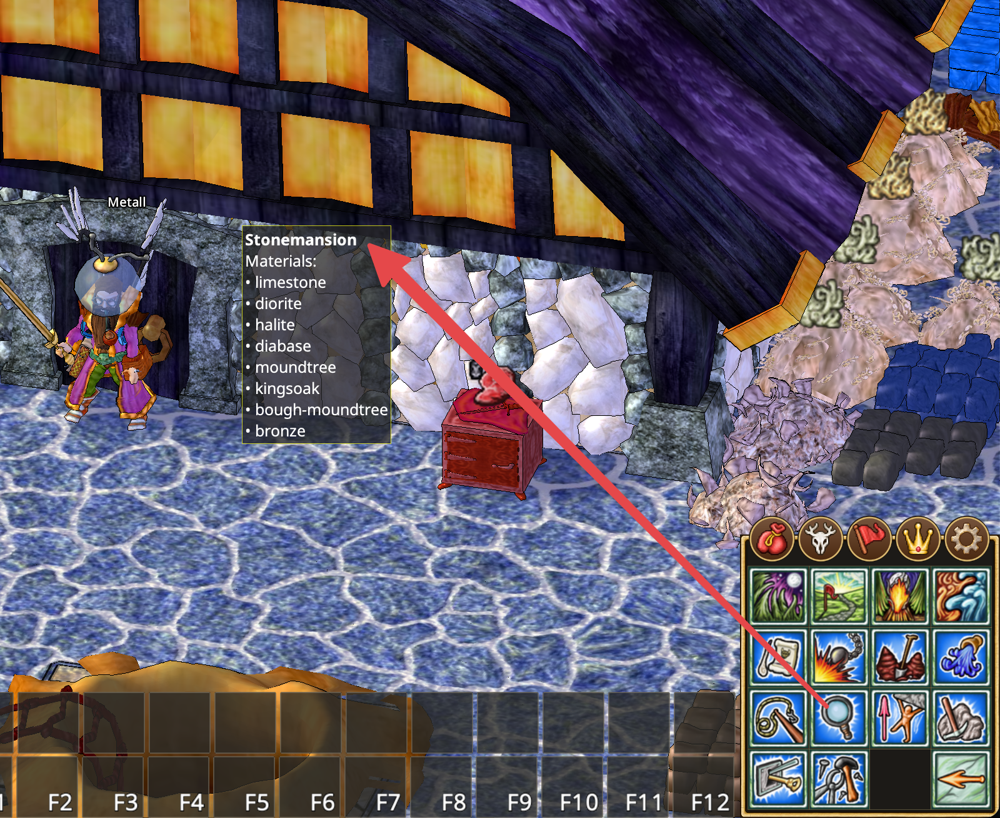
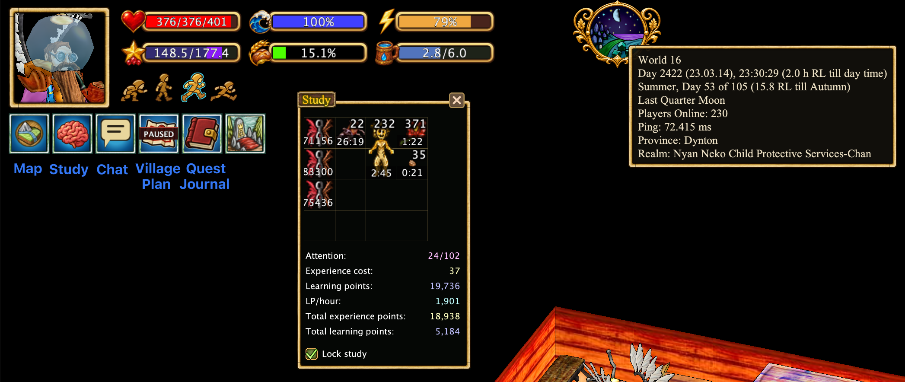
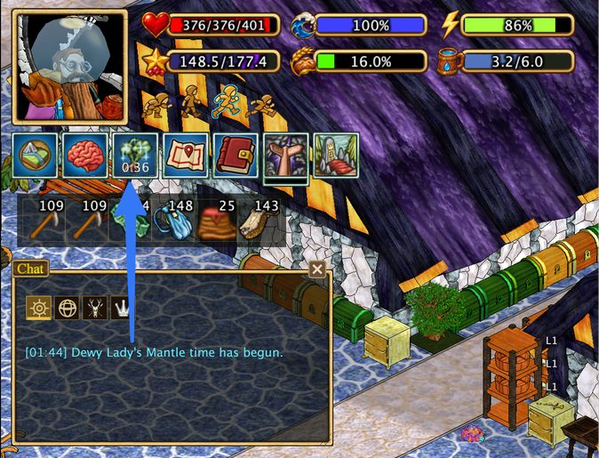
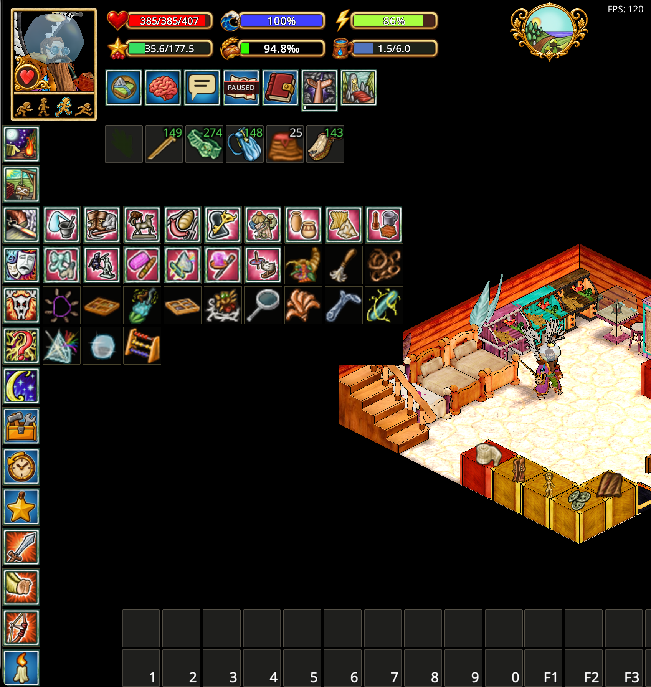
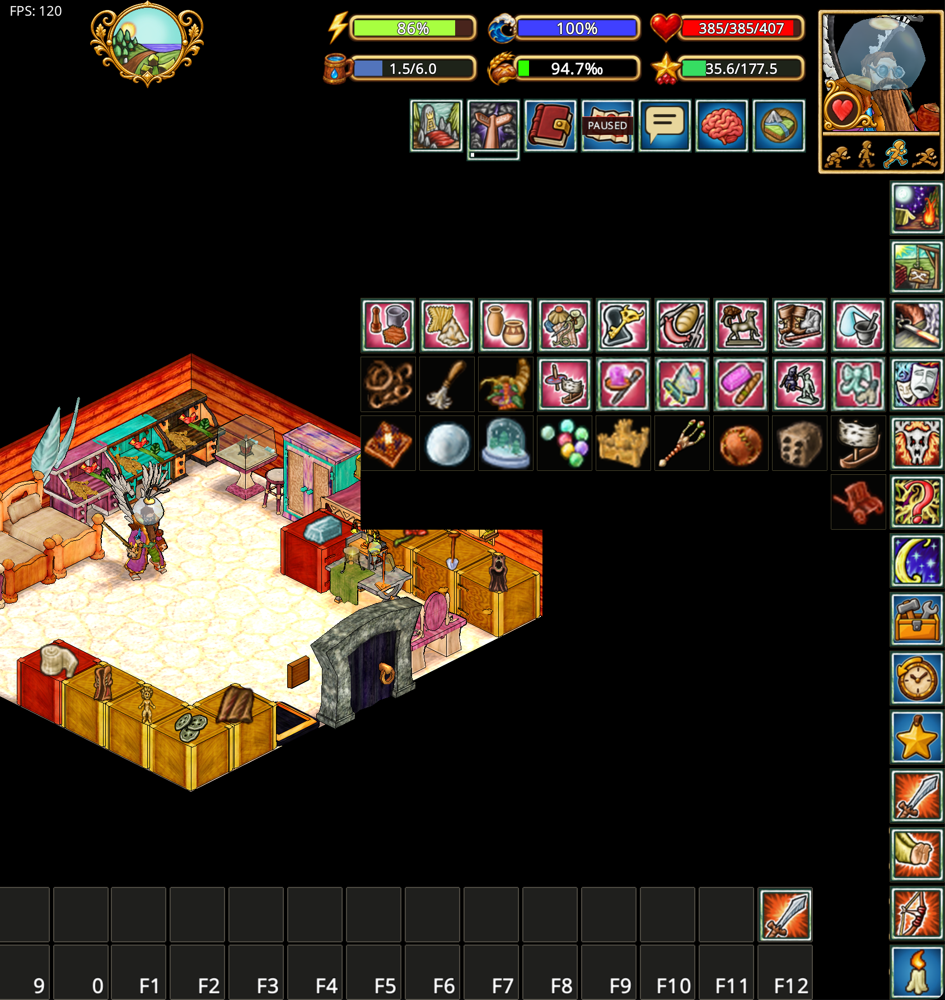
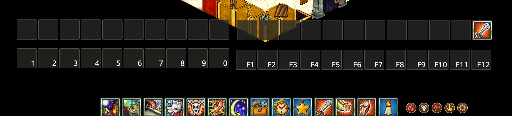
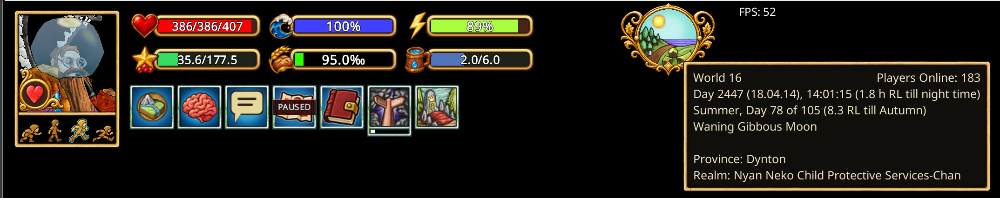
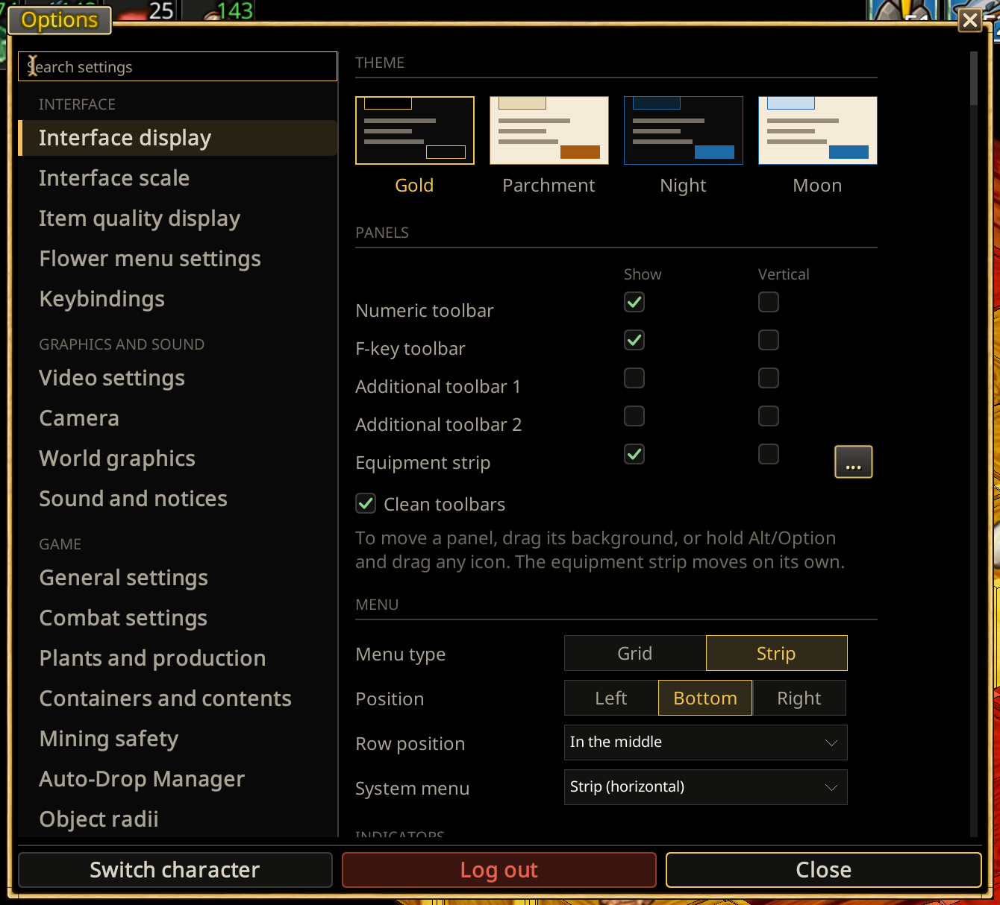

# Настраиваемый интерфейс Hearthborn

Интерфейс можно перестроить под размер экрана и привычный стиль игры.

## Вход и выбор персонажа

На входе изображён путник у костра; при выборе персонажа - синий пейзаж с Ring of Brodgar без путника. Выход из аккаунта находится под созданием нового персонажа. Обе кнопки одинаковой ширины. Значки аккаунта расположены справа от персонажа на высоте списка персонажей.

Наш фон остаётся виден во время появления серверных экранов. После Play золотая надпись **«Загрузка…»** показывается до появления карты. Экран не ждёт все объекты вокруг и не блокирует интерфейс при загрузке текстуры надписи. Язык надписи соответствует языку клиента.

## Подсказки атрибутов и способностей

Наведите на базовый атрибут или способность в листе персонажа, чтобы увидеть краткое описание его влияния на бой, ремесло и другие механики. Описания основаны на разделах [атрибутов](https://ringofbrodgar.com/wiki/Attributes) и [способностей](https://ringofbrodgar.com/wiki/Abilities) Ring of Brodgar, доступны на русском и английском и работают без интернета. Штатная разбивка базового значения и бонусов сохраняется выше описания.

## Прогноз жареной рыбы и мяса

Подсказки сырой рыбы, филе и мяса показывают прогноз обычного жаркого без приправ. Мир персонажа определяется по идентификатору, полученному от сервера. Для миров 16 и 16.2 расход голода считается в промилле: `(сумма FEP +1 + 2 × сумма FEP +2) / коэффициент еды × (качество / 10)^(1/4)`. FEP продолжают расти как квадратный корень из качества; повышенное качество улучшает отношение FEP к голоду. Например, у жареного угря при Q10 прогноз составляет 0,64‰, а при Q160 - 1,28‰.

Прогноз использует качество сырья; фактическое качество жарки ограничено восприятием и выживанием. Бонус свежего жаркого повышает и FEP, и расход голода на 25%. Бонусы стола в прогноз не включены. Готовая еда сохраняет сведения сервера. Если мир или коэффициент продукта не подтверждён, вместо голода показывается прочерк и пояснение.

Формула основана на [объявлении World 16](https://www.havenandhearth.com/forum/viewtopic.php?f=39&t=76519). Изменения [World 16.2](https://www.havenandhearth.com/forum/viewtopic.php?f=39&t=80996) в восстановлении голода со временем не подменяют расход голода самой еды. Коэффициенты и уточнения базовых значений сверены 12 ноября 2026 года с [Kitten Rider Cookbook](https://cookbook.kittenrider.com/), данные [CC BY 4.0](https://creativecommons.org/licenses/by/4.0/); в клиент включены переработанные значения. При наведении сеть не используется.

## Улучшенный Inspect (осмотр)

Действие **Inspect** показывает дополнительную информацию об объектах игрового мира. Например, при осмотре здания можно увидеть, **из каких материалов оно построено**, включая использованные виды камня, дерева и металла.

Если **зажать Shift во время осмотра**, появится техническая информация, в том числе **внутреннее название игрового ресурса**. Это помогает определить точный ресурс объекта, а не только его отображаемое название.

## Виджеты интерфейса

В Hearthborn есть компактные **виджеты** для часто используемых окон и информации. Они позволяют не держать все полноразмерные окна постоянно открытыми.

- **Карта (Map):** карту можно полностью закрыть. Вместо неё остаётся **виджет карты**; клик по нему снова открывает карту.
- **Чат (Chat):** когда чат закрыт, появляется **виджет чата**. Непрочитанные сообщения отмечаются индикатором на виджете. Клик открывает чат. В настройках можно включить **автоматическое открытие чата при новом сообщении**. **Системные сообщения не считаются** новыми сообщениями чата и не вызывают автоматического открытия.
- **Изучение (Study):** **значок мозга** появляется, если в окне изучения есть свободные слоты. Клик открывает **компактное окно изучения**.
- **План владений (Claim Plan):** клик открывает **план деревенского или личного владения**.
- **Журнал заданий (Quest Journal):** клик открывает журнал. При **наведении** показываются активный квест и его задания.
- **Часы (Clock):** при **наведении** отображается дополнительная информация о мире и игровой сессии. В настройках можно включить **индикаторы FPS и пинга до сервера**; они появятся **справа от часов**.
- **Манжетка с росой:** на рассвете (04:45–07:15 игрового времени) появляется значок статуса с обратным отсчётом, а в начале и конце этого времени звучит сигнал и приходит сообщение в чат. Уведомление можно отключить в общих настройках.

## Содержимое шкафов с первого взгляда

Hearthborn показывает **значок предмета над каждым шкафом**, автоматически выбирая тот предмет, **которого внутри больше всего**. Достаточно **хотя бы один раз открыть шкаф**, чтобы клиент узнал его содержимое. В настройках шкафа можно вручную выбрать другой значок, а также изменить размер и цвет индикатора.

Эти же ранее полученные сведения о шкафах могут отображаться на **плане дома**, который описан ниже. Сам план данные не собирает.

## План дома

В оригинальном клиенте при входе в дом на месте карты отображался квадрат текущего дома, а на чёрном фоне могли быть видны такие же квадраты соседних домов. Hearthborn заменяет этот вид **планом дома**, который показывается в той же области интерфейса.

На плане видна схема помещения и может отображаться **содержимое шкафов, которые хотя бы раз открывали**. При этом **сам план дома не собирает данные о предметах**: их заранее записывает отдельный скрипт, а план лишь отображает уже полученную информацию. Если шкаф ни разу не открывали, сведений о его содержимом для отображения ещё нет.

Так карта внутри дома становится полезной: можно посмотреть, где лежат ранее обнаруженные предметы, не открывая каждый шкаф заново.

## Оставшаяся прочность построек

В **Настройки → Общие настройки** включите **«Показывать оставшуюся прочность построек (%)»** - первый флажок в правой колонке. Повреждённые сооружения подсвечиваются красным, над ними появляется оставшаяся прочность: **75% означает, что разрушена четверть**. У полностью отремонтированных сооружений подписи нет.

## Скрытие деревьев и кустов

Нажмите **Ctrl + H**, чтобы скрыть деревья. На их месте останутся **видимые пни**. Так листва не перекрывает землю и предметы, но при этом видно, где находятся деревья.

По умолчанию **Ctrl + H скрывает только деревья**. Чтобы одновременно скрывать **кусты**, включите соответствующую опцию в настройках. У кустов нет собственных пней, поэтому скрытые кусты обозначаются **маленьким пеньком шелковицы**.

Hearthborn также отображает **стадии роста деревьев**, чтобы было проще следить за их развитием.

**Деревья и кусты скрыты**

**Деревья и кусты отображаются**

## Выбор меню действий

В **Настройки → Отображение интерфейса → Меню** у **Типа меню** два варианта: **Сетка** и **Полоса**. Других типов меню нет.

**Сетка** (классическое меню 4×4) сохраняет привычную иерархию действий Haven & Hearth. Пункт **Сторона** ставит её в левый или правый нижний угол, а **Меню Xtensions** выбирает, как раскрываются расширенные команды: **Обычное (4×4)**, **Вверх (4×12)** или **Вбок (12×4)**.

**Боковое меню** (**Тип меню → Полоса**) показывает список категорий и раскрывает вложенные действия. Переключение находится в **Настройки → Отображение интерфейса → Меню**.

Боковое меню **закреплено и не перетаскивается**. **Положение** ставит его колонкой на **левый** или **правый** край либо рядом **снизу** (цифровая панель поднимается над ним); для ряда **Положение ряда** ставит его слева, посередине или справа. Раскрытые меню всегда остаются в пределах высоты колонки.

Новые открытые действия и ведущие к ним категории подсвечиваются зелёным
и кратко мигают, как в классической сетке.

## Перемещаемое системное меню

В классическом меню системные кнопки всегда стоят **вокруг сетки 4×4**, поэтому выбор
**Системное меню** там скрыт. При боковом меню выберите **Полоска (горизонтально)**
(по умолчанию) или **Полоска (вертикально)** в **Настройки → Отображение интерфейса → Системное меню**.
Выбор сохраняется и применяется сразу; во всех вариантах те же кнопки, состояния
и сочетания клавиш. В полоске: инвентарь, личные клеймы, клеймы деревни, провинции и настройки.
Снаряжение и лист персонажа открываются кликом по портрету: **ЛКМ** - снаряжение,
**ПКМ** - лист персонажа (подсказка при наведении на портрет). У неё нет подложки, масштаб всегда 1,0, и
ползунок масштаба панелей её не меняет. «Родня и друзья» - это сердце на портрете,
а поиск действий - последний пункт бокового меню.

У классической сетки системные кнопки стоят одним рядом из пяти кнопок над ней ровно по её
ширине: инвентарь, снаряжение, персонаж, родня и настройки. Показ клеймов (личных,
деревни, провинций) находится в меню действий в разделе **Самоуправление**, а
поиск действий - последний пункт главной сетки.
У сетки и ряда под кнопками
общая тёмная подложка. Золотая рамка такая же, как у остальных панелей; кнопки
отступают от неё и используют светлые золотые кольца толщиной два пикселя.
Все системные кнопки используют одинаковые тёмные диски с отдельными рисунками;
настройки обозначены шестерёнкой без внешнего кольца.
При наведении кольцо становится ярче, а у открытого окна или включённого слоя
владений диск получает тёмно-золотую заливку. Каждая кнопка занимает пятую часть
ширины сетки. Верхний ряд остаётся над первыми четырьмя колонками при раскрытии
Xtensions вбок; свободное место справа не растягивает промежутки. Этот вариант перемещается вместе с
сеткой; с боковым меню используется полоска до возврата к классическому.

Пустые ячейки сетки действий и цифровой, F-клавишной и дополнительной панелей
имеют общую тёмную заливку и тонкий контур. Подписи назначенных клавиш сохраняются.

**Полоску** можно перемещать по экрану, как дополнительные панели быстрого доступа. Она **остаётся там, куда вы её поставили**. Эта позиция сохраняется пока выбрана классическая сетка, и восстанавливается при переключении обратно.

Чтобы переместить меню, **потяните за зазор между кнопками** или **зажмите Alt (Option на Mac) и перетащите кнопку**. При перетаскивании с Alt/Option **кнопка не срабатывает**.

Пока вы не переместили меню, оно остаётся **в исходном углу экрана**.

Кнопки управления картой и миникартой не увеличиваются при наведении.
Подсветка и подсказки сохраняются.

## Панели быстрого доступа

Панели F-клавиш и цифровые панели можно перемещать и располагать горизонтально или вертикально. Зазоров между ячейками нет. Две дополнительные панели содержат 10 и 12 ячеек и совпадают по размеру с цифровой панелью и панелью F-клавиш соответственно. Каждую можно отдельно переместить, скрыть или повернуть вертикально в **Отображении интерфейса**. Их размер не меняется при добавлении значков и изменении размера экрана. Назначения значков и положение панелей сохраняются.

## Клавиши для дополнительных панелей

Для каждой кнопки **Дополнительной панели 1** (10 кнопок) и **Дополнительной панели 2** (12 кнопок) можно назначить свою клавишу. Откройте **Настройки → Сочетания клавиш → Панели**, нажмите кнопку напротив нужной и нажмите клавишу или сочетание; **Escape** отменяет, **Backspace** возвращает значение по умолчанию (без клавиши), **Delete** очищает. Клавиша привязана к месту на панели, от первой кнопки до последней, и использует ту иконку, что там стоит, как щелчок. Клавиша показывается в углу своей кнопки. Если клавишу уже занимает другое сочетание, назначение отклоняется с сообщением, какое именно. Пока панель скрыта, её клавиши не работают.

## Портрет и индикаторы

Положение портрета, показателей состояния и элементов интерфейса можно адаптировать под правую или левую сторону экрана.

## Оформление и масштаб

Настройки масштаба собраны в **Настройки → Масштаб интерфейса**: масштаб интерфейса, масштаб портрета, размер шрифта и масштаб панелей (он меняет только панели кнопок: меню 4×4, панели 0–9 и F, дополнительные панели и полосу экипировки; окна сохраняют размер). Светлое оформление, панели кнопок, рамки, перетаскивание и магнитное выравнивание окон остаются в **Отображении интерфейса**.
Миникарта, чат и журнал заданий в колонке стыкуются без зазора, с одной общей
золотой линией на каждом стыке. Заголовки нижних окон находятся внутри непрозрачных
шапок и не перекрывают окно выше. Клик по любому окну поднимает всю колонку,
сохраняя порядок окон сверху вниз. У краёв экрана заголовки остаются полностью видимыми.

## Обновлённое окно персонажа (Character Sheet)

В обновлённом **Character Sheet** характеристики персонажа и информация о питании собраны в более наглядном виде. Таблица **Base Attributes** показывает базовые значения, положительные и отрицательные модификаторы и итоговые показатели. В **Food Satiations** отображаются виды пищи и текущие проценты насыщения, а **Food Event Points** и **Hunger Level** представлены отдельными полосами прогресса. Значки разделов окна персонажа остаются доступны внизу.

## Окно экипировки и бонусы

В окне **Equipment** появилась панель **Equipment bonuses**, которая показывает суммарные бонусы от надетого снаряжения. В ней отображаются прибавки к характеристикам и навыкам, а также к способности обучения, вместимости инвентаря, отражению и поглощению урона бронёй, **Concealment (Int × Ste)** и **Detection (Prc × Exp)**. Это позволяет оценить эффект экипировки, не просматривая каждый предмет отдельно.

На значке надетого лука в полоске снаряжения справа снизу показано общее количество стрел при себе: отдельные стрелы, паки, вложенные сумки и надетый колчан. Открывать их окна не нужно. В подсказке под обычными характеристиками лука показаны количество и среднее качество каждого типа стрел. Среднее взвешено по количеству отдельных стрел, включая паки. Знак «?» означает, что количество или качество ещё неизвестно.

## Журнал заданий, чат и экипировка

Выполнение действий показывает компактный индикатор: собственные песочные часы,
золотое кольцо прогресса и процент снизу. Кольцо следует данным сервера; фон
прозрачный, у текста только тонкая обводка. Отмена действий работает как прежде.

Окна журнала заданий, чата и экипировки можно расположить удобнее, не перекрывая основные игровые элементы.

При входе и смене размера игрового окна чат возвращается в доступную область экрана. Если его размер больше экрана, он уменьшается; закрытый чат остаётся закрытым. **Ctrl + C** открывает чат и возвращает его окно в видимую область.

Привязка миникарты, чата и журнала к краю экрана и друг к другу сохраняется
между входами. При смене разрешения или масштаба окна следуют выбранному краю;
временное ограничение границ не сбрасывает привязку. Открытие карты через её
значок возвращает её в видимую область. Перетаскивание в свободное место или
изменение размера снимает соответствующую привязку.

**Чат и журнал заданий** можно растягивать за заметные штрихи в **левом нижнем углу рамки**: тяните влево, чтобы увеличить ширину, и вниз, чтобы увеличить высоту. Верхний и правый края остаются на месте. **Двойной щелчок по этому углу** возвращает размер и положение до растягивания. У чата ручка работает и без рамки.

В **правом нижнем углу** чата, журнала и карты есть такая же золотая ручка поверх содержимого: тяните вправо и вниз, сохраняя верхний и левый края на месте. Область захвата занимает весь квадрат 20×20, а не только штрихи. У карты двойной щелчок по правому углу также возвращает прежний размер.

## Шрифты

Весь текст рисуется шрифтом Noto Sans, который входит в клиент; ничего
устанавливать не нужно. Размер текста меняется в **Настройки → Масштаб интерфейса**
ползунком **Размер шрифта** (75–150 %). Новый размер применяется после перезапуска клиента.

Новые дополнительные панели используют локальные слоты и изначально пусты.
Действия с других серверных страниц панели не подхватываются автоматически.
Существующая сохранённая раскладка дополнительных панелей и её назначения
сохраняются. Перетащите значок из меню в ячейку для добавления; ПКМ удаляет значок.

## Компактный режим

Полоска виджетов под портретом вмещает **16 значков в один ряд** до переноса.
Боевые эффекты сохраняют прежние восемь значков в ряду.

**Alt + Space** включает компактный интерфейс, освобождая место на экране.

## Примеры оформления

[Все функции](../index.md#features)
