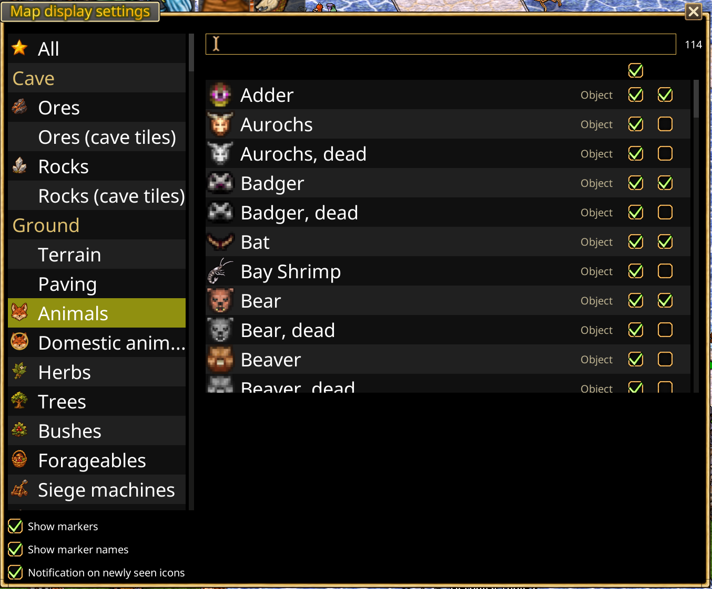

# Map icons and display settings

Map markers have been expanded with many additional icons, making it easier to recognize objects and points of interest. Animal indicators can also provide **animal sounds**.

The **Map Display Settings** have been redesigned, and the map includes a dedicated **Icon Settings** control for managing the icon display.

## Open the map on a second monitor

You can open the map in a **separate window** and move it to a **second monitor**. See [Map in a separate window](map-window.md).

The map tools also include mine-support ranges and configurable object radii.

Red animal circles, including the beaver circle, follow the terrain. A confirmed dead or knocked-out pose hides the circle; an unloaded pose alone keeps it visible.

[Back to features](../../README.md#features)
