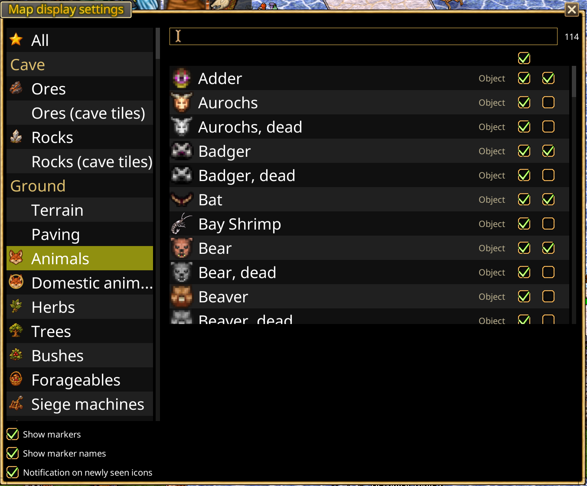

# Значки и настройки карты

Карта получила дополнительные значки для обозначения объектов и ориентиров, в том числе связанные с животными. Настройки карты и значков вынесены в более удобные панели.

Можно управлять отображением значков, звуков животных, радиусов объектов и зон действия шахтных опор.

## Качество ресурсов на карте

Если применить **Осмотр** к ресурсу, у которого есть метка на карте (кремнёвая россыпь, глиняная яма и подобное), сообщённое качество дописывается к имени метки: **Flint Wash (q44)**. Оно показывается при включённом **Показывать названия меток** в настройках карты, сохраняется между сессиями, а сама метка не меняется. Некоторые ресурсы, например глиняный бассейн, при осмотре качество не сообщают. Для них качество берётся из того, что они дают: если вы использовали такой ресурс и рядом с ним в инвентаре появился предмет с качеством (карьерная глина из глиняного бассейна), это качество дописывается к названию. Чтобы обновить число, осмотрите ресурс или используйте его ещё раз.

Карту можно открыть **в отдельном окне** и перенести на **второй монитор**: подробности в разделе [Карта в отдельном окне](map-window.md).

Красные круги животных, включая бобра, следуют рельефу. Круг скрывается при подтверждённой смерти или оглушении; недогруженная поза сама по себе его не скрывает.

[Все функции](../index.md#features)
