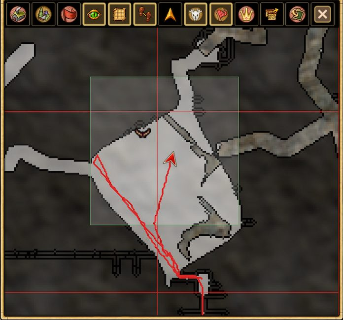
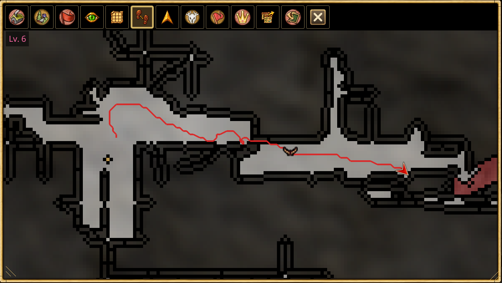
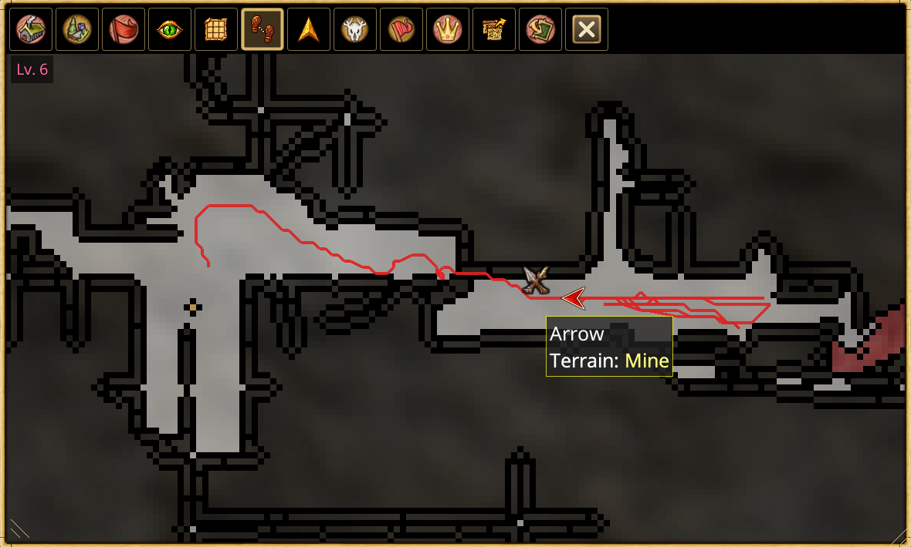
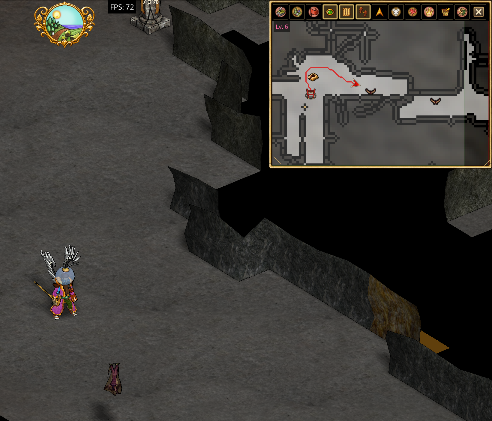

# Маршрут текущей сессии

Включите **Show Session Trail**, чтобы увидеть на карте путь, который персонаж прошёл после начала текущей сессии.

Маршрут отображается только во время **текущего запуска игры**. Он не записывается на диск и не сохраняется для следующих сессий.

[Все функции](../index.md#features)
