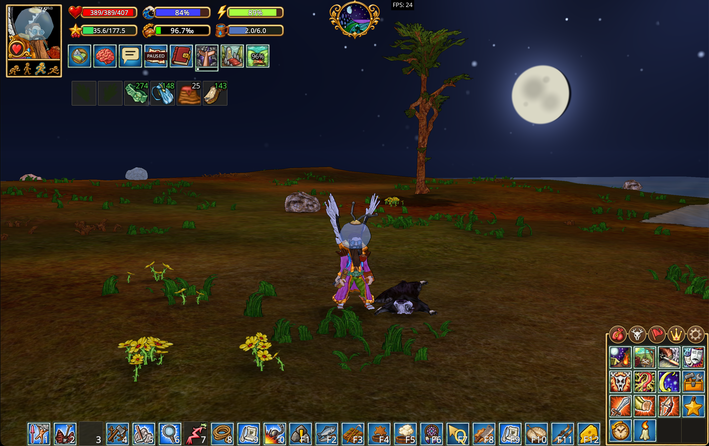

# Sky

With a camera that can look at the horizon, Hearthborn draws a **sky** above the world: the colour of the air follows the height of the sun, dawn and dusk glow on the horizon, clouds drift, and at night stars, a faint Milky Way and the moon with its current phase appear.

The sun and the moon stand where the game's light comes from, so the sky matches the time of day on the server. The picture is calculated by the graphics card, with no ready-made images, so it has no visible seams.

## Where to turn it on

Open **Options → Camera**:

- **Sky** chooses what is drawn: **Day and night** (the default), **Starry lake** (a still picture with a far forest) or **Off**.
- **Tilt the camera below the horizon** lets the Free, Simple and Following cameras tilt low enough to look at the sky.

Orthographic cameras show no sky. With the other cameras the sky is visible when the camera looks towards the horizon or the view is pulled far out.

The sky is hidden where it does not belong: inside houses, cellars and mines.

[Back to features](../index.md#features)
