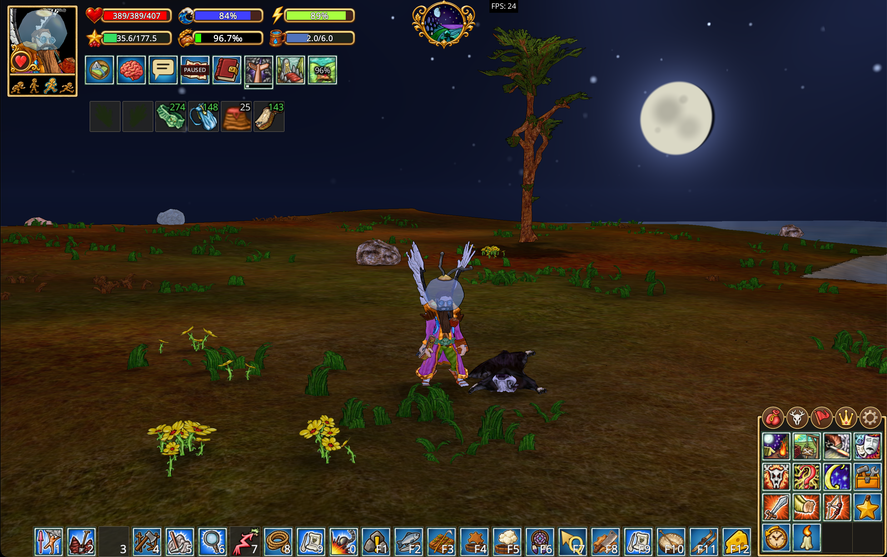

# Небо

Если камера может смотреть на горизонт, Hearthborn рисует над миром **небо**: цвет воздуха зависит от высоты солнца, на горизонте светятся рассвет и закат, плывут облака, а ночью появляются звёзды, слабый Млечный Путь и луна в её текущей фазе.

Солнце и луна стоят там, откуда идёт свет в игре, поэтому небо соответствует времени суток на сервере. Картинка рассчитывается видеокартой без готовых изображений, поэтому на ней нет видимых швов.

## Где включить

Откройте **Настройки → Камера**:

- **Небо** выбирает, что рисовать: **День и ночь** (по умолчанию), **Звёздное озеро** (неподвижная картинка с далёким лесом) или **Выкл.**
- **Опускать камеру ниже горизонта** позволяет камерам «Свободная», «Простая» и «Следящая» наклоняться достаточно низко, чтобы смотреть на небо.

В ортографических камерах неба нет. В остальных камерах небо видно, когда камера смотрит к горизонту или вид сильно отдалён.

Там, где неба быть не должно, оно скрывается: в домах, подвалах и шахтах.

[Все функции](../index.md#features)
