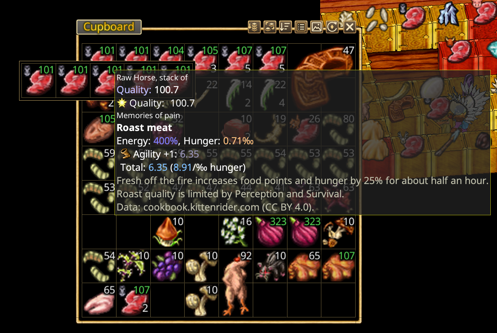
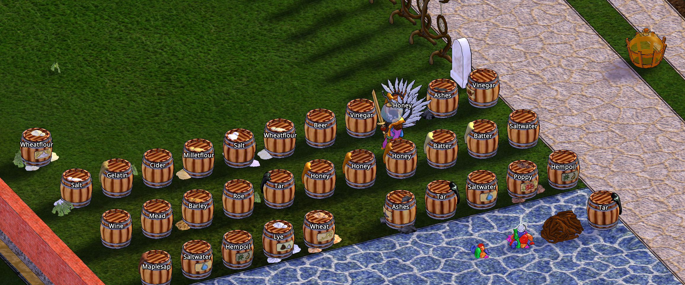
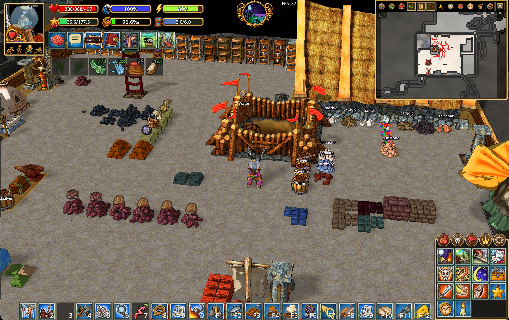

# Storage and production visibility

The **Container overview** starts collapsed whenever you open the backpack or a
container. Closing or hiding its owner also closes the overview and its menus or
dialogs, restores the compact window size, and keeps it collapsed when reopened.

## Cupboard contents at a glance

This also works for **Metal Cabinets**. In the open container's header, use
**Choose icon**, then click an item to set its picture. **Automatic icon** returns
to the most numerous observed content. Open the container first to learn its
contents; the choice is saved for its map location. The **Container icons**
visibility setting applies to both cupboards and metal cabinets.

Contents icons above cupboards, cabinets and stockpiles are hidden by buildings
and other opaque objects in front of them.

A cupboard automatically displays an icon of the **item it contains the most of**, so you can see its main contents without opening it. **You must open the cupboard at least once for this feature to work**, so the client can observe its contents. If you prefer a different icon, you can **choose your own item icon in the cupboard's settings**. You can also **adjust the size and color of the cupboard's displayed indicator**.

## Barrel contents labels

Hearthborn displays the **contents of barrels as labels above them**.

The game server does not provide the barrel's contents automatically. Until you inspect a barrel, the client can only tell whether it is **empty or full**; **empty barrels are highlighted in orange**.

**Open a barrel at least once during the current session** to let Hearthborn identify its contents and show the corresponding label above it. The information is based on what the client has actually observed, rather than hidden server data.

- Identify observed stone, clay, brick, metal, and ore stockpiles visually. **Stone, brick, and clay stockpiles can use distinct colors** to make materials easier to distinguish. You can **disable material-based color differentiation** in the settings.
- Optionally **highlight empty and full containers** to recognize their fill state at a glance.
- **Hold Space** to display the names of rock stockpiles.
- Show cheese rack labels, selected object radii, and useful production information in the world.

**Trash, flower and wool stockpiles show an item icon above them, like ore piles.** Deposit or
withdraw an item, or create the pile, to identify it. The client remembers the
last confirmed item's picture, including its subtype, for that map location.
An unknown pile has no icon; observing an empty pile clears it. For a mixed pile,
the icon is a sample of its contents, not a complete inventory. Use **Stockpile
materials and contents** in the settings to control these indicators and material textures.

## Ready-to-collect tanning equipment

**Drying racks for hides** and **tanning tubs** are **highlighted in green when their contents are ready to collect**. This makes it easier to spot completed processing without checking each rack or tub individually.
**Curding tubs** also turn green when curd is ready. Empty tubs and tubs with
milk still processing keep their normal appearance; readiness comes from the
server's visible curd state, without opening the tub.
Use **Options → Plants and production → Highlight finished objects**.
Readiness takes priority over the red damage tint; cracks and remaining-health
numbers stay visible. Turning readiness off restores the usual damage tint.
The same panel controls **production progress on items**, automatic countdown
labels above objects, and automatic process-timer creation. Percentages use
server data from production windows; the switch does not hide study or buff meters.
Container colours remain available through the button in that panel.

## Item transfers and stockpile controls

Hearthborn adds shortcuts for moving matching items while keeping different materials separate when needed.

| Action | Shortcut | Result |
| --- | --- | --- |
| Drop one item on the ground | **Ctrl + left-click** the item | Drops only the clicked item. |
| Drop all identical items | **Ctrl + Alt + left-click** the item | Drops that item and all items matching both its **name and resource**. |
| Deposit everything a stockpile accepts | **Shift + left-click** the stockpile | Uses the stockpile's server-side action to take all accepted items from your inventory. Different stone types may be mixed. |
| Deposit only the held stack | Pick up a stack onto the cursor and click the stockpile normally | Deposits only the held stack; other stone types in your inventory remain. |
| Deposit only the held subtype into a stockpile | **Shift + right-click** an existing stockpile with an item held | Transfers only the subtype held on the cursor. |
| Deposit all accepted items into a stockpile | **Shift + Ctrl + right-click** an existing stockpile with an item held | Transfers all accepted items, including other subtypes. |
| Transfer matching items into an open container | **Shift + Ctrl + click** an item (default shortcut) | Transfers items with the same name from the same inventory or bag. **Left-click** starts with the highest quality; **right-click** starts with the lowest. |
| Fill a feeding trough | Hold seeds on the cursor and **Shift + right-click** the trough (**Shift + Ctrl** acts the same) | Deposits the held seeds and matching seeds from your inventory. |

### Transferring items from stacks

**Stacked items can be transferred directly**, including ore stored in stacks inside your inventory or bag. When you click a stack to transfer its contents to another container or a production station, such as an **ore smelter or oven**, Hearthborn handles the items inside the stack.

If the destination **cannot accept a stack as a single object**, Hearthborn automatically takes the individual items out of the stack and transfers them to the destination. You do not need to unpack the stack manually first.

### Why exact-name stockpile deposits matter

A stockpile may accept several subtypes, such as different stones or animal entrails. With an item held on the cursor, **Shift + right-click on an existing stockpile** requests only the held subtype; **Shift + Ctrl + right-click** requests all accepted subtypes. Hide piles are the exception described below. To create a new pile, right-click suitable ground with the item, then confirm its placement with **Shift + left-click** for only that subtype, or **Shift + Ctrl + left-click** for all accepted subtypes. The modifier at the placement click selects the filling mode. Planting and placing other objects keep their usual gestures.

**Feeding troughs:** With seeds on the cursor, **Shift + right-click** and **Shift + Ctrl + right-click** act the same: the held seeds and matching seeds in your inventory go in, but not the other items the trough would accept.

**Hide piles are the exception:** **Shift + right-click** deposits all accepted hides, so different species and raw/dried hides can share a pile. **Shift + Ctrl + right-click** keeps the held subtype. For a new hide pile, use the corresponding modifiers when confirming placement with left-click.

For container transfers, the client only selects matching item names from the **same inventory or bag**. An open chest, cupboard, or table can receive the transfer. Different items, such as granite and basalt, are not transferred together. You can change the shortcut in **Keyboard Settings → “Transfer identical items (with click)”**.

### Matching items: inventory and bags

Use **Shift + Ctrl + click** to transfer every item with the same name **from the inventory or bag you clicked in**. **Left-click** processes the highest-quality items first; **right-click** starts with the lowest quality. Change the shortcut under **Keyboard Settings → “Transfer identical items (with click)”**.

When transferring from a **bag** to an open chest, cupboard, or crate, items are moved **one at a time**: the server cannot take them directly out of the bag. When you click a **stack in the main inventory**, its contents are transferred too, not just the icon at the top.

### Stockpile Take control

At the bottom of the stockpile window, enter an amount and press **Take**. An **empty field or 0** takes everything; a **positive number** takes exactly that many items, if available.

The mouse wheel over a stockpile still deposits or takes **one item at a time**. Hold **Shift** while scrolling to move items in batches.

### Inventory buttons and container overview

- **Stack** fills partial stacks and combines the remaining loose items, checking server updates until consolidation is complete. Different resources and item names stay separate. **Unstack** separates stacks. Both buttons remain in the container header. Cupboards also have header buttons for manual icon selection and a return to the automatic icon.
- **Sort** with **left-click** puts higher-quality items first; **right-click** puts lower-quality items first. **Large items stay in place**.
- **Container overview** opens a side panel with a solid background, English/Russian name search, item counts and average quality. Expand a group with its arrow to see quality groups. If all quality values match, each physical item or stack gets its own row, with its own quantity and precise quality; the tooltip includes the range and precise weighted average. Loaded stacks are counted by the items inside. Seed labels omit the duplicate quantity, and packages of the same seed with different counts share a group.
- Click **Item**, **Qty** or **Avg. quality** to sort the overview. Click again to reverse the direction shown by ↑/↓. Quality uses the amount-weighted average, with unknown quality always last. Expanded rows stay under their group. Sorting the overview only reorders the list.
- **Left-click** selects a group and highlights its items. **Double left-click on the same row** transfers the entire group to the backpack, preserving stacks: eight lemons in two stacks still occupy two cells. The system double-click interval is used. The entire group is sent directly in one batch, without cursor pickup or waits between items. Items that cannot fit stay in the source; the footer reports the amount moved. Unknown quality appears as **?**.
- **Shift + left-click** takes one best-quality item; **Shift + right-click** takes one worst-quality item, without changing selection. Add **Ctrl** to take up to five. On an expanded quality row these gestures take items of that quality. Counted seed packets are not split into smaller packets.
- **Right-click** opens a compact flat menu about 270 px wide just below the row (above it near the bottom edge of the window), so the row stays visible. **To backpack** (2×LMB) comes first, then **Best** and **Worst** rows with ready quantity buttons: 1, the two configurable amounts and “…” for a custom number (Shift+LMB / Shift+RMB). One click instead of two. Below a divider: **Drop below Q…** and the red **Drop all…**. Shortcuts appear in gray on the right only where they exist, and there is no title. Nested rows (a single stack or a quality) get a shorter menu: **To backpack** and **Drop**, with discard confirmation. The gesture legend is a tooltip on the “?” at the end of the status line and is not shown while a menu is open. Transferring all items of a quality requires whole stacks; a partial mixed-quality stack must be moved through its main group instead. Escape or clicking outside closes the menu.
- The small **bin** at the end of a group row opens **Drop below quality**. A positive decimal threshold with a point or comma selects stacks whose average quality is **strictly less than the threshold**. Equal quality and stacks with any unknown-quality member are kept. An empty value never means “drop all”.
- **Drop all…** selects every item of this exact type in the source, including unknown quality. It matches the full item name and resource, keeping different meat species separate even when they share a base icon. It requires a red confirmation by default. Dropping a selected quality always requires confirmation.
- Number dialogs remember the last value separately for take and discard, show a live preview, and accept **Enter** / cancel with **Escape**. The take preview allows for available inventory cells. Discard confirmation rechecks identities, quantities and qualities: changed contents require another review. Loading items, an occupied cursor, an active transfer or a closed source block the action.
- The single footer shows the hovered/selected group or container totals; action results remain for about three seconds. The **?** tooltip lists all gestures. The compact gesture hint hides after 20 successful uses. In **Options → Containers → Container overview controls**, restore hints, change the quick amounts (default 5 and 10), or disable confirmation for dropping a whole group. Click the overview header button again to restore the container's previous size.

### Dropping poor mined items

The inventory header has no drop button. Poor-quality mined items are dropped by the **Auto-Drop Manager** (**Options → Mining safety → Auto-Drop Manager**; see [Mining safety](mining-safety.md)). Use the overview context menu or row bin for a single discard by full item name or quality threshold.

**Keep the cursor empty** before sorting, stacking or unstacking, or using the matching-item transfer shortcut.

### Other production interactions

**Tar kiln:** With an empty cursor, **Shift + right-click** the kiln to collect the finished coal into your backpack in one batch, as space allows. **Right-click → Collect coal** also collects the finished coal, but one piece at a time. Neither action collects tar.

**Grain barrel:** To fill an empty barrel, pick up one grain stack and **Shift + right-click the barrel itself**. Hearthborn deposits the held stack first, then transfers matching stacks from the main inventory as the barrel accepts them. A plain **right-click with a stack on the cursor** deposits only that stack. The open-window **Shift + Ctrl + left-click** shortcut is a separate transfer and may not work on an empty barrel.

[Back to features](../../README.md#features)

### Automatic item stacking

**Options → General → Automatic item stacking** sets the game's own stacking toggle (the server stacks picked-up items for you) to the chosen state at every login and immediately when you change it. Until you tick or untick the box, the game's saved setting is left alone. The client does not stack items itself; the **Stack** button in the inventory header still does a one-off stacking.
