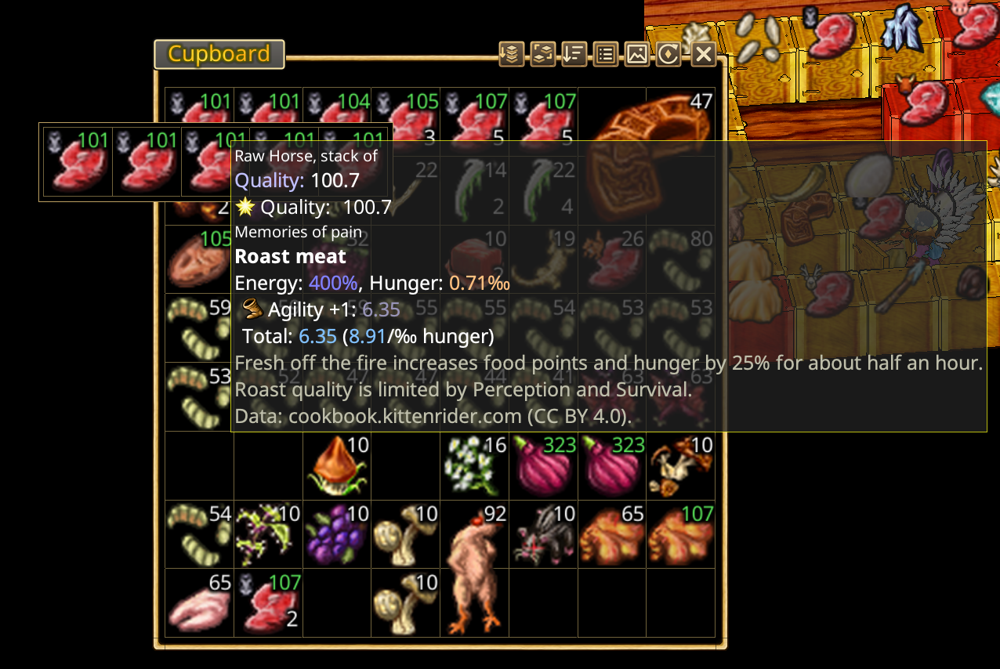
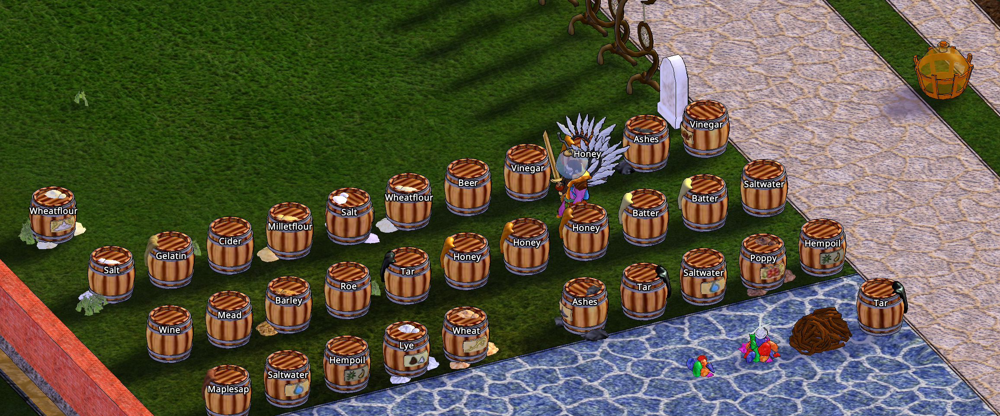
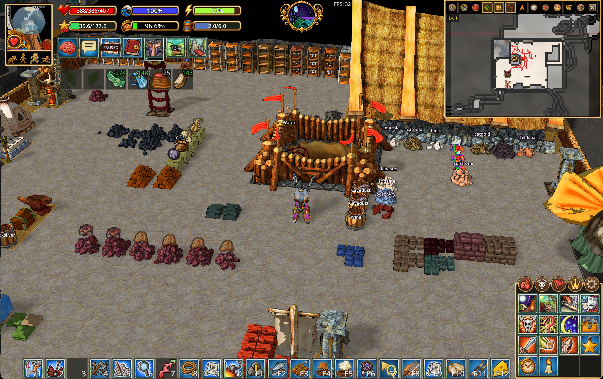

# Хранилища и производство

**Обзор контейнера** изначально свёрнут при каждом открытии рюкзака или
контейнера. Закрытие или скрытие основного окна закрывает обзор, его меню и
диалоги, возвращает компактный размер; при повторном открытии обзор свёрнут.

## Содержимое шкафа с первого взгляда

Это работает и для **металлического кабинета (Metal Cabinet)**. В заголовке
открытого контейнера есть **Выбрать иконку**: нажмите её и затем нужный предмет.
**Автоматическая иконка** возвращает картинку самого многочисленного содержимого.
Чтобы узнать содержимое, сначала откройте контейнер; выбор сохраняется для его
места на карте. Настройка **Значки контейнеров** общая для шкафов и кабинетов.

Значки содержимого над шкафами, кабинетами и кучами скрываются за зданиями
и другими непрозрачными объектами перед ними.

Над шкафом автоматически отображается **картинка предмета, которого в нём больше всего**. **Чтобы функция заработала, необходимо хотя бы один раз открыть шкаф**, чтобы клиент получил информацию о его содержимом. Так можно сразу понять, что преимущественно хранится в шкафу, не открывая его. При желании **в настройках шкафа можно выбрать свою картинку предмета** вместо автоматически определённой, а также **изменить размер и цвет отображаемого значка**.

Hearthborn позволяет быстрее понять, что хранится в предметах и складах, не открывая их по одному.

## Подписи содержимого бочек

Hearthborn показывает **содержимое бочек в виде подписей над ними**.

Игровой сервер не передаёт клиенту информацию о содержимом бочки автоматически. До открытия можно определить только, **пуста бочка или полна**. **Пустые бочки подсвечиваются оранжевым цветом**.

Чтобы над бочкой появилась подпись её содержимого, **откройте её хотя бы один раз в текущей игровой сессии**. Клиент отображает только ту информацию, которую уже получил при открытии, а не скрытые данные сервера.

- **Склады руды:** значки помогают различать содержимое.
- **Камень, кирпич и глина:** могут использоваться разные цвета и обозначения. **Различение цветов по материалам можно отключить** в настройках.
- **Пустые и полные контейнеры:** можно включить **подсветку по степени заполнения**, чтобы сразу видеть их состояние.
- **Пробел (Space):** удерживайте, чтобы показать названия складов камня.
- **Сырные стеллажи:** подписи помогают отслеживать продукцию.

Отображается только содержимое, о котором клиент располагает сведениями.

**Над кучами мусора (Trash), цветов (Flower) и шерсти (Wool) показывается значок
предмета, как над кучами руды.** Положите или возьмите предмет либо создайте кучу, чтобы опознать
её. Клиент запоминает картинку последнего подтверждённого предмета, включая
подтип, для этого места на карте. Неизвестная куча остаётся без значка;
при осмотре пустой кучи он сбрасывается. Для смешанной кучи значок показывает
образец содержимого, а не полный список. Настройка **Материалы и содержимое куч**
управляет этими значками и текстурами материалов.

## Готовые шкуры и дубильные чаны

**Сушилки для шкур** и **дубильные чаны** **подсвечиваются зелёным цветом, когда содержимое готово к сбору**. Так можно сразу увидеть, где обработка завершена, не проверяя каждую сушилку или чан по отдельности.
**Чан для творога (Curding Tub)** тоже становится зелёным, когда творог готов.
Пустой чан и чан с ещё не свернувшимся молоком сохраняют обычный вид.
Готовность определяется по состоянию творога от сервера, открывать чан не нужно.
Настройка: **Настройки → Растения и производство → Подсвечивать готовую продукцию**.
Зелёная готовность имеет приоритет над красной подсветкой износа; трещины и
процент оставшейся прочности сохраняются. При отключении готовности возвращается
обычная подсветка износа. Здесь же можно включить **прогресс производства на
предметах**, таймеры над объектами и автоматическое создание таймеров процессов.
Проценты берутся из данных сервера в производственных окнах; прогресс изучения
и индикаторы эффектов этот переключатель не скрывает. Цвета контейнеров доступны
через кнопку в том же разделе.

## Перекладывание предметов и работа со складами

Hearthborn добавляет сочетания клавиш для быстрого переноса одинаковых предметов и разделения разных материалов.

| Действие | Сочетание | Результат |
| --- | --- | --- |
| Выбросить один предмет на землю | **Ctrl + левая кнопка** по предмету | Выбрасывается только выбранный предмет. |
| Выбросить все точно такие же предметы | **Ctrl + Alt + левая кнопка** по предмету | Выбрасываются предмет и все совпадающие с ним **по имени и ресурсу**. |
| Положить в склад всё подходящее | **Shift + левая кнопка** по самому складу | Сервер забирает из инвентаря всё, что склад принимает. Разные виды камня могут перемешаться. |
| Положить только взятую стопку | Взять стопку на курсор и обычным кликом положить в склад | Переносится только эта стопка, остальные виды камня остаются в инвентаре. |
| Положить в кучу только подтип на курсоре | **Shift + правая кнопка** предметом на курсоре по существующей куче | Переносится только тот подтип, который находится на курсоре. |
| Положить в кучу всё подходящее | **Shift + Ctrl + правая кнопка** предметом на курсоре по существующей куче | Переносятся все принимаемые предметы, включая разные подтипы. |
| Переложить однотипные предметы в открытый контейнер | **Shift + Ctrl + клик** по предмету (по умолчанию) | Переносятся предметы с тем же именем из того же инвентаря или сумки. **Левая кнопка** начинает с лучшего качества, **правая** - с худшего. |
| Заполнить кормушку | Взять семена на курсор и нажать **Shift + ПКМ** по кормушке (**Shift + Ctrl + ПКМ** действует так же) | В кормушку попадают семена с курсора и однотипные семена из инвентаря. |

### Перекладывание предметов из стаков

**Предметы можно перекладывать прямо из стаков**, например руду, сложенную в стак в инвентаре или сумке. При клике по стаку для переноса в другой контейнер или производственный объект, например **плавилку или печь**, Hearthborn обрабатывает предметы внутри стака.

Если место назначения **не принимает стак целиком**, клиент автоматически достаёт предметы из стака по отдельности и перекладывает их. Вручную распаковывать стак перед переносом не требуется.

### Перенос всех подходящих предметов или одного подтипа

Одна куча может принимать несколько подтипов: например, разные камни или потроха животных. **Shift + ПКМ предметом на курсоре по существующей куче** запрашивает перенос только такого же подтипа. **Shift + Ctrl + ПКМ** запрашивает перенос всех принимаемых подтипов. Для куч шкур действует исключение, описанное ниже. Для новой кучи нажмите ПКМ предметом по подходящей земле, затем подтвердите размещение: **Shift + ЛКМ** - только такой же подтип, **Shift + Ctrl + ЛКМ** - всё принимаемое. Режим наполнения выбирается сочетанием при подтверждении размещения. Посадка и размещение других объектов сохраняют обычные сочетания.

**Исключение - кучи шкур:** **Shift + ПКМ** складывает все принимаемые шкуры, включая разные виды животных и сырые/сушёные шкуры. **Shift + Ctrl + ПКМ** оставляет отбор по подтипу на курсоре. Для новой кучи шкур используйте соответствующее сочетание при подтверждении размещения левой кнопкой.

При переносе в контейнер выбираются предметы с одинаковым именем **из того же инвентаря или сумки**. Открытый сундук, шкаф или стол может их принять. Гранит не переносится вместе с базальтом. Сочетание можно изменить в **настройках клавиатуры → «Переложить однотипные предметы (с кликом)»**.

### Однотипные предметы: инвентарь и сумки

**Shift + Ctrl + клик** переносит все предметы с тем же именем **из того инвентаря или сумки, где выполнен клик**. **Левая кнопка** начинает с лучшего качества, **правая** - с худшего. Сочетание меняется в **настройках клавиатуры → «Переложить однотипные предметы (с кликом)»**.

Из **сумки** в открытый сундук, шкаф или ящик предметы переносятся **по одному**: сервер не умеет самостоятельно забирать их из сумки. При клике по **стопке в основном инвентаре** переносится и её содержимое, а не только верхняя иконка.

### Кнопка Take в окне стокпайла

В нижней части окна стокпайла есть поле количества и кнопка **Take**. **Пустое поле или 0** забирает всё; **положительное число** - ровно указанное количество, если оно доступно.

**Колесо мыши над кучей** по-прежнему кладёт или забирает **по одному предмету**. **Shift + колесо** перемещает предметы пачкой.

### Кнопки инвентаря и обзор содержимого

- **Stack** дополняет неполные стопки и объединяет оставшиеся одиночные предметы, сверяя результат с ответами сервера до завершения укладки. Разные ресурсы и названия не смешиваются. **Unstack** раскладывает стопки. Обе кнопки находятся в заголовке контейнера. В заголовке шкафа также доступны выбор значка и возврат автоматического значка.
- **Sort:** **левая кнопка** сортирует от лучшего качества к худшему, **правая** - от худшего к лучшему. **Крупные предметы остаются на месте**.
- **Обзор содержимого** открывает справа список с плотным фоном, поиском по русскому или английскому названию, количеством и средним качеством. Стрелка у группы раскрывает группы качества. Если качество одинаковое, каждый предмет или стопка из сетки показаны отдельной строкой со своим количеством и точным качеством; диапазон и точное среднее показаны в подсказке. Для загруженных стопок учитываются предметы внутри. В названиях семян количество не дублируется; упаковки одного вида с разным количеством объединяются.
- Нажмите заголовок **«Предмет»**, **«Кол-во»** или **«Ср. кач.»**, чтобы отсортировать обзор. Повторное нажатие меняет направление, показанное стрелкой ↑/↓. Качество сравнивается по среднему с учётом количества; неизвестное качество остаётся внизу. Раскрытые строки остаются под своей группой. Сортировка обзора меняет только список.
- **ЛКМ** выбирает группу и подсвечивает её предметы. **Двойной ЛКМ по одной строке** переносит всю группу в рюкзак, сохраняя стопки: восемь лимонов в двух стопках занимают две ячейки. Используется системный интервал двойного клика. Вся группа отправляется напрямую одной партией, без взятия на курсор и ожидания между предметами. То, что не поместилось, остаётся в источнике; статус показывает фактически взятое количество. Неизвестное качество обозначается **?**.
- **Shift + ЛКМ** берёт один предмет лучшего качества; **Shift + ПКМ** - худшего, не меняя выделение. С **Ctrl** берётся до пяти. На раскрытой строке качества эти жесты берут предметы этого качества. Пачки семян на более мелкие пачки не делятся.
- **ПКМ** открывает компактное плоское меню шириной около 270 px прямо под строкой (у нижнего края окна - над ней), так что строка остаётся видна. Первым стоит **«В рюкзак»** (2×ЛКМ), затем строки **«Лучшие»** и **«Худшие»** с готовыми кнопками количества: 1, два настраиваемых числа и «…» для своего (Shift+ЛКМ / Shift+ПКМ). Одно нажатие вместо двух. Ниже, за разделителем: **«Выбросить ниже Q…»** и красное **«Выбросить всё…»**. Горячие клавиши показаны серым справа только там, где они есть; заголовка нет. У вложенных строк (отдельная стопка или качество) меню короче: **«В рюкзак»** и **«Выбросить»**, с подтверждением выброса. Легенда жестов открывается подсказкой на «?» в углу строки статуса и не показывается, пока открыто меню. Массовый перенос требует целых стопок; часть смешанной стопки переносите через основную группу, чтобы её не распаковать. Esc или клик вне меню закрывает его.
- **Корзина** справа в строке группы открывает **«Выбросить ниже качества»**. Дробное число через точку или запятую выбирает стопки со средним качеством **строго ниже порога**. Равное качество и стопки с неизвестным качеством хотя бы одного предмета сохраняются. Пустое поле не означает «выбросить всё».
- **«Выбросить всё…»** выбирает все предметы именно этого вида в исходном контейнере, включая неизвестное качество. Учитываются полное имя и ресурс: разные виды мяса с общей иконкой не смешиваются. По умолчанию требуется красная кнопка подтверждения. Выброс выбранного качества всегда требует подтверждения.
- Числовые диалоги отдельно запоминают последние значения переноса и порога качества, показывают живой расчёт, принимают **Enter** и отменяются по **Esc**. При расчёте переноса учитываются свободные ячейки. Перед выбросом заново проверяются предметы, количество и качество; изменившийся состав нужно проверить ещё раз. Загрузка предметов, занятый курсор, активный перенос и закрытый исходный контейнер блокируют действие.
- Единственная нижняя строка показывает группу под курсором/выделение либо итог по контейнеру; результат действия остаётся примерно на три секунды. Подсказка **?** перечисляет жесты. Короткая подсказка скрывается после 20 успешных применений. В **Настройки → Контейнеры → Управление обзором содержимого** можно вернуть её, изменить быстрые количества (по умолчанию 5 и 10) и отключить подтверждение выброса целой группы. Повторное нажатие кнопки обзора возвращает прежний размер контейнера.

### Выбрасывание слабых шахтных предметов

В заголовке инвентаря кнопки выбрасывания нет. Шахтные предметы низкого качества выбрасывает **Менеджер автовыбрасывания** (**Настройки → Безопасность шахты → Менеджер автовыбрасывания**, см. [Безопасность шахт](mining-safety.md)). Для разового выбрасывания по полному имени или порогу качества используйте меню обзора или корзину в строке.

**Перед сортировкой, работой со стопками и переносом однотипных предметов курсор должен быть пустым.**

### Другие действия с производственными объектами

**Смоляная печь:** с пустым курсором нажмите **Shift + ПКМ** по печи, чтобы забрать готовый уголь в рюкзак сразу, сколько поместится. **ПКМ → «Собрать уголь»** тоже собирает весь готовый уголь, но по одной штуке. Смолу эти действия не забирают.

**Зерно в бочку:** чтобы заполнить пустую бочку, возьмите стопку зерна на курсор и нажмите **Shift + ПКМ по самой бочке**. Клиент сначала кладёт стопку с курсора, затем перекладывает однотипные стопки из основного инвентаря, пока бочка их принимает. **Обычный ПКМ** со стопкой на курсоре кладёт только эту стопку. **Shift + Ctrl + ЛКМ** по зерну при открытой бочке - отдельное действие, и на пустой бочке оно может не сработать.

[Все функции](../index.md#features)

### Автоматическая укладка в стопки

**Настройки → Общие → Автоматическая укладка предметов в стопки** выставляет встроенный переключатель игры (сервер сам складывает подобранные предметы) в выбранное состояние при каждом входе и сразу при изменении. Пока галочка не тронута, сохранённая настройка игры не меняется. Сам клиент предметы не укладывает; кнопка **Стопки** в заголовке инвентаря по-прежнему делает разовую укладку.
