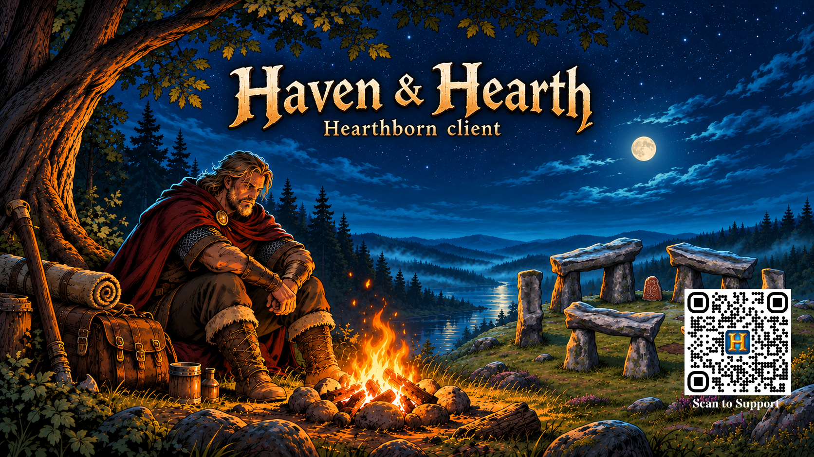
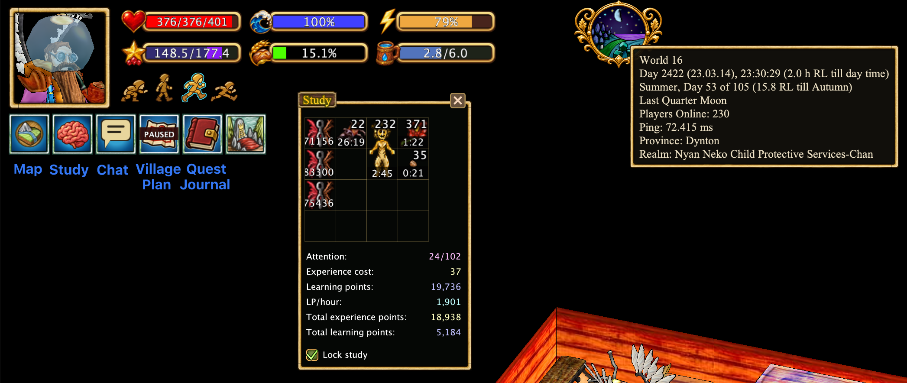
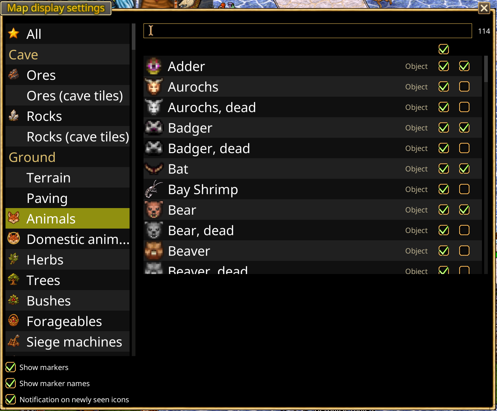
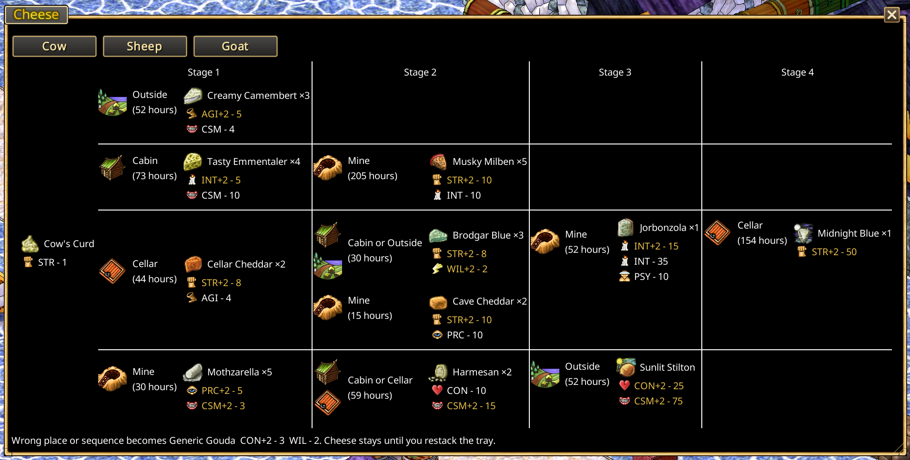
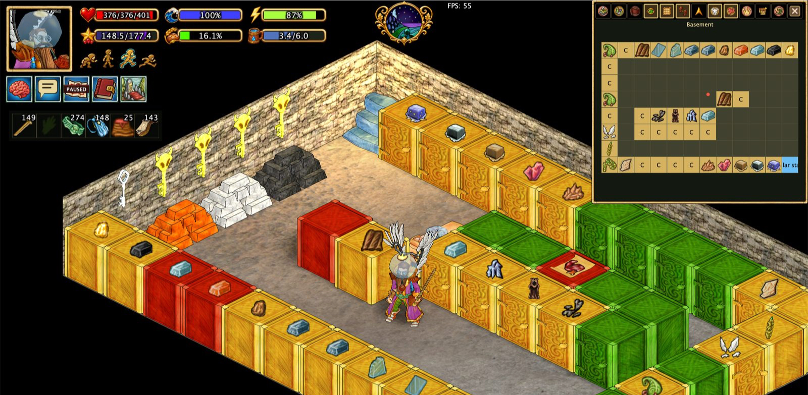
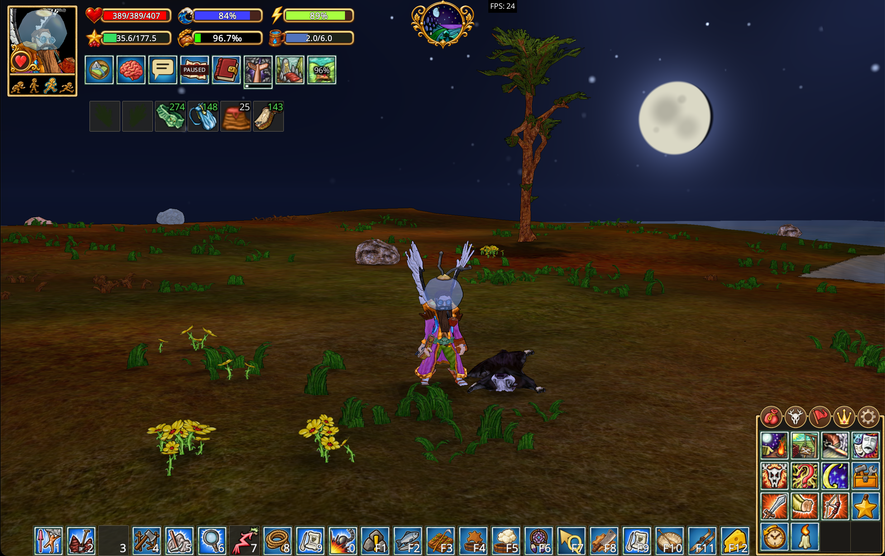

# Hearthborn Client

**A custom client for Haven & Hearth**

*Plan your village. Simplify production. Explore with better tools.*

[Features](#features) · [Documentation](#documentation) · [Privacy](#privacy) · [Support development](#support-development) · [Screenshots](#screenshots)

Built on top of the original (vanilla) Haven & Hearth client, Hearthborn is an independent, unofficial custom client focused on improving everyday gameplay through a customizable interface and tools for village management, production, exploration, mining, and more.

**Languages:** English and Russian (approximately 98% of the client translated into Russian) · **Technology:** Java 22 / Apache Ant

## Features

Explore each feature in its own illustrated guide.

### 🎛️ Interface & controls

- [**Redesigned interface**](https://jagy2014.github.io/hearthborn/features/interface/) — Classic 4×4 or sidebar menu, movable toolbars, snapping windows, mirrored HUD, and compact mode.
- [**Redesigned Action Search**](https://jagy2014.github.io/hearthborn/features/action-search/) — Favorites, history, recipe details, and ingredient search.
- [**Sky**](https://jagy2014.github.io/hearthborn/features/sky/) — Day and night drawn by the graphics card: sun, moon phases, clouds and stars.

### ⚙️ Production & management

- [**Quality Roster**](https://jagy2014.github.io/hearthborn/features/quality-roster/) — Record object quality and display known values on your plans.
- [**Cattle Roster**](https://jagy2014.github.io/hearthborn/features/cattle-roster/) — Redesigned livestock overview with automatic removal of slaughtered animals.
- [**Village & Claim Planner**](https://jagy2014.github.io/hearthborn/features/claim-plan/) — Automatically map observed structures, name areas, measure tiles, and export or import plans.
- [**Cheese Production Assistant**](https://jagy2014.github.io/hearthborn/features/cheese/) — Cheese aging stages, rack labels, and progression chart.
- [**Automatic Timers**](https://jagy2014.github.io/hearthborn/features/timers/) — Production, cheese, siege, claim, and manual timers.
- [**Storage & Production Visibility**](https://jagy2014.github.io/hearthborn/features/storage/) — Cupboard contents, stockpile identification, and object labels.
- [**Automation & Xtensions**](https://jagy2014.github.io/hearthborn/features/scripts/) — Helpers for fuel, workstations, crops, animals, and other repetitive tasks.

### 🗺️ Navigation & exploration

- [**Improved Pathfinding**](https://jagy2014.github.io/hearthborn/features/pathfinding/) — On by default, with optional horseback navigation.
- [**Mapping & Exports**](https://jagy2014.github.io/hearthborn/features/mapping/) — Transfer maps between clients or export images and tiles.
- [**Session Trail**](https://jagy2014.github.io/hearthborn/features/session-trail/) — View your route for the current session without recording it.
- [**Map Icons & Display Settings**](https://jagy2014.github.io/hearthborn/features/map-icons/) — More icons, animal sounds, and redesigned map controls.
- [**Meteorite Triangulation**](https://jagy2014.github.io/hearthborn/features/meteorite/) — Narrow a meteorite search area using Star Gaze observations.

### ⛏️ Mining & combat

- [**Reimagined Minesweeper**](https://jagy2014.github.io/hearthborn/features/mining-safety/) — Mark cave tiles, inspect dust clues, and manage mining safety options.
- [**Combat Assistance**](https://jagy2014.github.io/hearthborn/features/combat/) — Animal auto-combat and a compact combat interface.

## Getting started

Hearthborn is an unofficial custom client for Haven & Hearth. Installation and launcher instructions will be linked here when a verified distribution is available.

To explore the available features and controls, start with the [interface guide](https://jagy2014.github.io/hearthborn/features/interface/) and [automation guide](https://jagy2014.github.io/hearthborn/features/scripts/).

## Documentation

Detailed guides with screenshots are available throughout the documentation. Start with the [interface guide](features/interface.md) or [storage and stockpiles](features/storage.md), or use the feature links above to open individual guides.

**Note:** Timers, quality information, maps, and automation rely on data actually observed by the client. They do not reveal unexplored information or guarantee successful actions.

## Privacy

**Hearthborn does not send your data to third-party services.** It only sends the data required to connect to and play on the official **Haven & Hearth servers**.

## Support development

Hearthborn is free for everyone. Donations are voluntary and help support continued development, bug fixes, and new features. They do not unlock exclusive features or provide in-game advantages.

**[❤️ Support Hearthborn on Buy Me a Coffee](https://buymeacoffee.com/hearthborn_client)**

## Credits and license

Hearthborn is an independent project based on the Haven & Hearth client. Original game and client credits belong to their respective authors. Refer to the upstream client for its original license terms.

## Screenshots

A quick look at Hearthborn's interface and tools. Click a feature name for the full guide.

| [Customizable interface](https://jagy2014.github.io/hearthborn/features/interface/) | [Village & claim planning](https://jagy2014.github.io/hearthborn/features/claim-plan/) |
| --- | --- |
|  |  |
| [Quality Roster](https://jagy2014.github.io/hearthborn/features/quality-roster/) | [Map icons & display settings](https://jagy2014.github.io/hearthborn/features/map-icons/) |
|  |  |
| [Cheese production](https://jagy2014.github.io/hearthborn/features/cheese/) | [Automation & Xtensions](https://jagy2014.github.io/hearthborn/features/scripts/) |
|  |  |
| [Cheese aging on racks](https://jagy2014.github.io/hearthborn/features/cheese/) | [Cupboard contents](https://jagy2014.github.io/hearthborn/features/storage/) |
|  |  |
| [Day and night sky](https://jagy2014.github.io/hearthborn/features/sky/) | [Moon and stars](https://jagy2014.github.io/hearthborn/features/sky/) |
|  |  |
