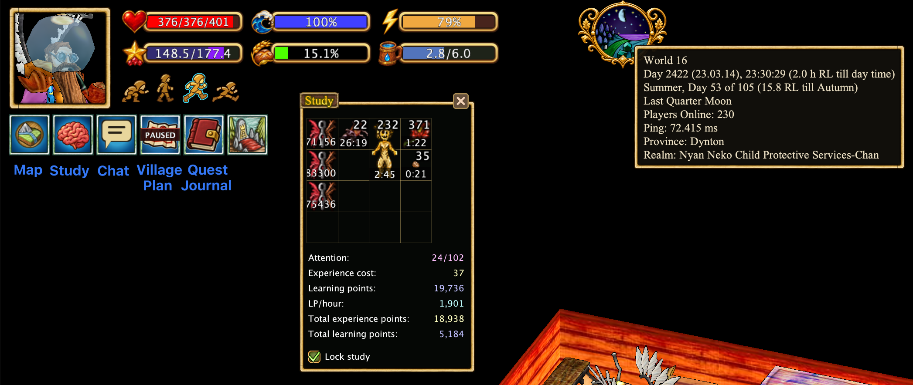
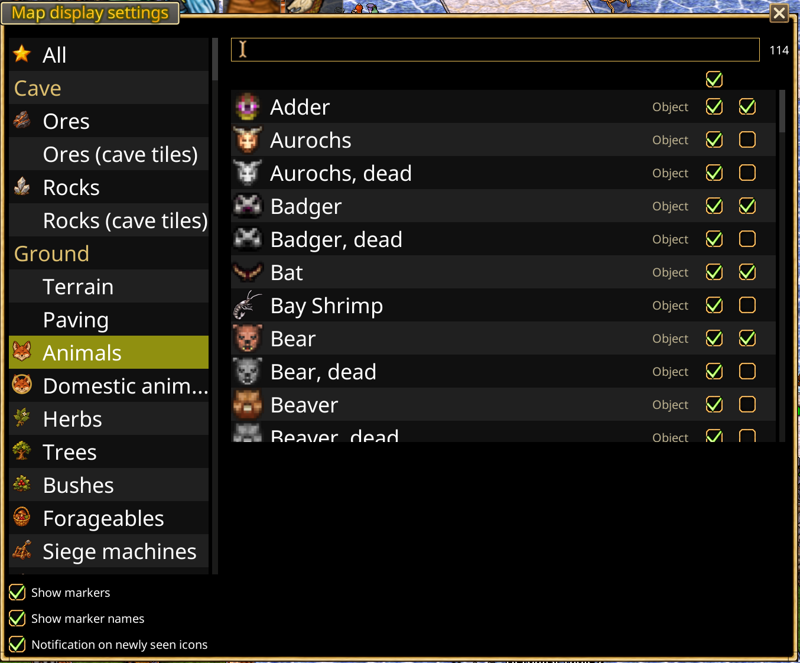
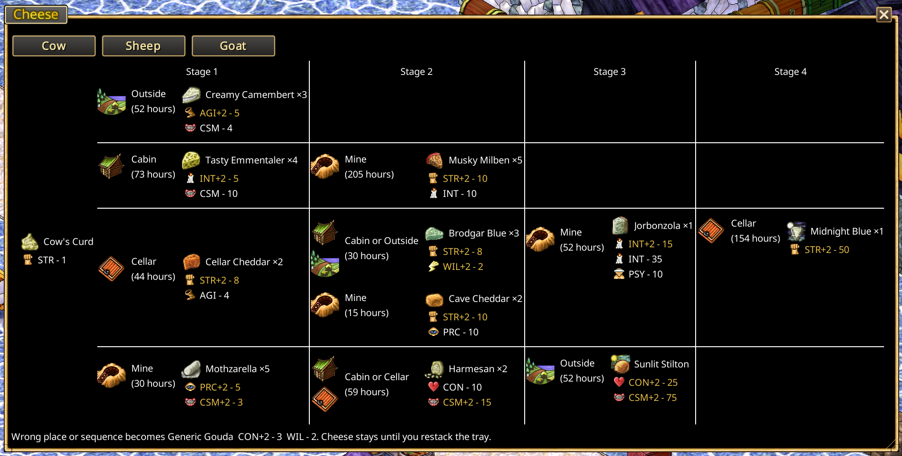
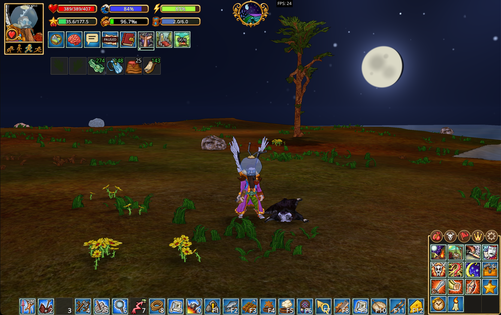

# Hearthborn Client

**Пользовательский клиент для Haven & Hearth**

*Планируйте деревню. Упрощайте производство. Исследуйте мир с более удобными инструментами.*

[Возможности](#features) · [Документация](#documentation) · [Конфиденциальность](#privacy) · [Поддержка разработки](#support-development) · [Скриншоты](#screenshots)

Hearthborn создан на основе оригинального (vanilla) клиента Haven & Hearth. Это независимый неофициальный клиент, который делает повседневную игру удобнее благодаря настраиваемому интерфейсу и инструментам для управления деревней, производства, исследования мира, шахт и многого другого.

**Языки:** английский и русский (примерно 98% интерфейса клиента переведено на русский) · **Технологии:** Java 22 / Apache Ant

## Возможности {#features}

Каждая возможность подробно описана в отдельном руководстве с иллюстрациями.

### 🎛️ Интерфейс и управление

- [**Переработанный интерфейс**](https://jagy2014.github.io/hearthborn/ru/features/interface/) - классическое меню 4×4 или боковое меню, перемещаемые панели инструментов, привязка окон, зеркальное расположение элементов интерфейса и компактный режим.
- [**Переработанный поиск действий**](https://jagy2014.github.io/hearthborn/ru/features/action-search/) - избранное, история, сведения о рецептах и поиск по ингредиентам.
- [**Небо**](https://jagy2014.github.io/hearthborn/ru/features/sky/) - день и ночь, нарисованные видеокартой: солнце, фазы луны, облака и звёзды.

### ⚙️ Производство и управление

- [**Журнал качества**](https://jagy2014.github.io/hearthborn/ru/features/quality-roster/) - запись качества объектов и отображение известных значений на планах.
- [**Журнал животных (Cattle Roster)**](https://jagy2014.github.io/hearthborn/ru/features/cattle-roster/) - обновлённый интерфейс учёта животных и автоматическое удаление забитых животных.
- [**Планировщик деревни и владений**](https://jagy2014.github.io/hearthborn/ru/features/claim-plan/) - автоматическое нанесение обнаруженных построек на план, названия областей, измерение клеток, экспорт и импорт планов.
- [**Помощник сыровара**](https://jagy2014.github.io/hearthborn/ru/features/cheese/) - стадии созревания сыров, подписи на стеллажах и схема развития сыров.
- [**Автоматические таймеры**](https://jagy2014.github.io/hearthborn/ru/features/timers/) - таймеры производства, сыров, осадных сооружений, владений и ручные таймеры.
- [**Отображение складов и производства**](https://jagy2014.github.io/hearthborn/ru/features/storage/) - содержимое шкафов, распознавание складируемых материалов и подписи объектов.
- [**Автоматизация и Xtensions**](https://jagy2014.github.io/hearthborn/ru/features/scripts/) - вспомогательные команды для топлива, производственных станций, растений, животных и других повторяющихся задач.

### 🗺️ Навигация и исследование

- [**Улучшенный поиск пути**](https://jagy2014.github.io/hearthborn/ru/features/pathfinding/) - включён по умолчанию, с дополнительной возможностью навигации верхом.
- [**Карта в отдельном окне**](https://jagy2014.github.io/hearthborn/ru/features/map-window/) - живая карта в собственном окне, которое можно перенести на второй монитор.
- [**Карта и экспорт**](https://jagy2014.github.io/hearthborn/ru/features/mapping/) - перенос карт между клиентами, экспорт изображений и отдельных тайлов.
- [**Маршрут сессии**](https://jagy2014.github.io/hearthborn/ru/features/session-trail/) - отображение маршрута текущей сессии без его записи на диск.
- [**Значки и настройки карты**](https://jagy2014.github.io/hearthborn/ru/features/map-icons/) - дополнительные значки, звуки животных и переработанные элементы управления картой.
- [**Триангуляция метеоритов**](https://jagy2014.github.io/hearthborn/ru/features/meteorite/) - определение примерной области падения метеорита по наблюдениям Star Gaze.

### ⛏️ Шахты и бой

- [**Переосмысленный «Сапёр»**](https://jagy2014.github.io/hearthborn/ru/features/mining-safety/) - отметки клеток пещеры, изучение подсказок от пыли и настройки безопасности шахт.
- [**Помощь в бою**](https://jagy2014.github.io/hearthborn/ru/features/combat/) - автоматизация боя с животными и компактный боевой интерфейс.

## Начало работы {#getting-started}

Hearthborn - неофициальный пользовательский клиент для Haven & Hearth. Он устанавливается через свой **лаунчер**: в нём уже есть Java 22, он скачивает и проверяет клиент и предлагает обновления.

1. Откройте [последний релиз](https://github.com/Jagy2014/hearthborn/releases/latest) и скачайте архив лаунчера для своей системы: `hearthborn-launcher-windows-x86_64.zip`, `hearthborn-launcher-macos-aarch64.zip` (Apple Silicon), `hearthborn-launcher-macos-x86_64.zip` (Mac на Intel) или `hearthborn-launcher-linux-x86_64.zip`.
2. Распакуйте **весь архив** в папку и запустите `Hearthborn.exe` (Windows), `Hearthborn.app` (macOS) или `Hearthborn/bin/Hearthborn` (Linux). При первом запуске лаунчер скачает клиент, около 100 МБ.

Лаунчер пока **не подписан**, поэтому при первом запуске система предупредит. В Windows нажмите **Подробнее → Выполнить в любом случае**. В macOS нажмите на приложение правой кнопкой (или с Control), выберите **Открыть** и ещё раз **Открыть**; если macOS всё равно отказывает, один раз выполните в Терминале `xattr -dr com.apple.quarantine Hearthborn.app`.

Лаунчер сам не обновляется: когда выходит новый, он один раз сообщает об этом, а кнопка **Новый лаунчер…** открывает страницу загрузки. Версии клиента и данные игры лежат отдельно (`%LOCALAPPDATA%\Hearthborn` в Windows, `~/Library/Application Support/Hearthborn` в macOS, `~/.local/share/hearthborn` в Linux) и сохраняются при замене лаунчера.

Чтобы познакомиться с доступными возможностями и управлением, начните с [руководства по интерфейсу](https://jagy2014.github.io/hearthborn/ru/features/interface/) и [руководства по автоматизации](https://jagy2014.github.io/hearthborn/ru/features/scripts/).

## Документация {#documentation}

Подробные руководства со скриншотами доступны в разделах документации. Начните с [руководства по интерфейсу](features/interface.md) или [хранилищам и складам](features/storage.md), либо воспользуйтесь ссылками на отдельные функции выше.

**Примечание:** таймеры, данные о качестве, карты и автоматизация опираются на информацию, которую клиент действительно получил во время игры. Они не раскрывают неизведанные сведения и не гарантируют успешного выполнения действий.

## Конфиденциальность {#privacy}

**Hearthborn не отправляет ваши данные сторонним сервисам.** Клиент передаёт только данные, необходимые для подключения и игры, на официальные **серверы Haven & Hearth**.

## Поддержка разработки {#support-development}

Hearthborn бесплатен для всех. Пожертвования добровольны и помогают продолжать разработку, исправлять ошибки и добавлять новые функции. Они не открывают эксклюзивных возможностей и не дают игровых преимуществ.

**[❤️ Поддержать Hearthborn на Buy Me a Coffee](https://buymeacoffee.com/hearthborn_client)**

## Авторы и лицензия {#credits-and-license}

Hearthborn - независимый проект на основе клиента Haven & Hearth. Права на оригинальную игру и клиент принадлежат их авторам. Условия исходной лицензии приведены в оригинальном проекте.

## Скриншоты {#screenshots}

Краткий обзор интерфейса и инструментов Hearthborn. Нажмите на название функции, чтобы открыть подробное руководство.

| [Настраиваемый интерфейс](https://jagy2014.github.io/hearthborn/ru/features/interface/) | [Планировщик деревни и владений](https://jagy2014.github.io/hearthborn/ru/features/claim-plan/) |
| --- | --- |
|  |  |
| [Журнал качества](https://jagy2014.github.io/hearthborn/ru/features/quality-roster/) | [Значки и настройки карты](https://jagy2014.github.io/hearthborn/ru/features/map-icons/) |
|  |  |
| [Сыроварение](https://jagy2014.github.io/hearthborn/ru/features/cheese/) | [Автоматизация и Xtensions](https://jagy2014.github.io/hearthborn/ru/features/scripts/) |
|  |  |
| [Созревание сыров на стеллажах](https://jagy2014.github.io/hearthborn/ru/features/cheese/) | [Содержимое шкафов](https://jagy2014.github.io/hearthborn/ru/features/storage/) |
|  |  |
| [Небо днём и ночью](https://jagy2014.github.io/hearthborn/ru/features/sky/) | [Луна и звёзды](https://jagy2014.github.io/hearthborn/ru/features/sky/) |
|  |  |
